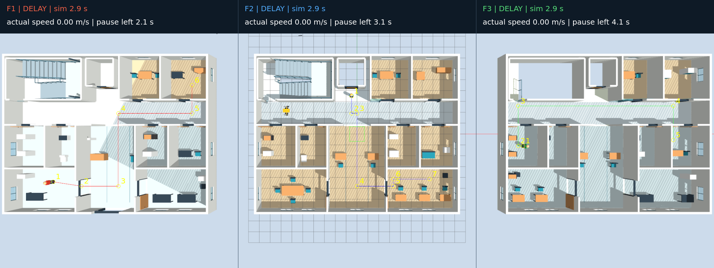
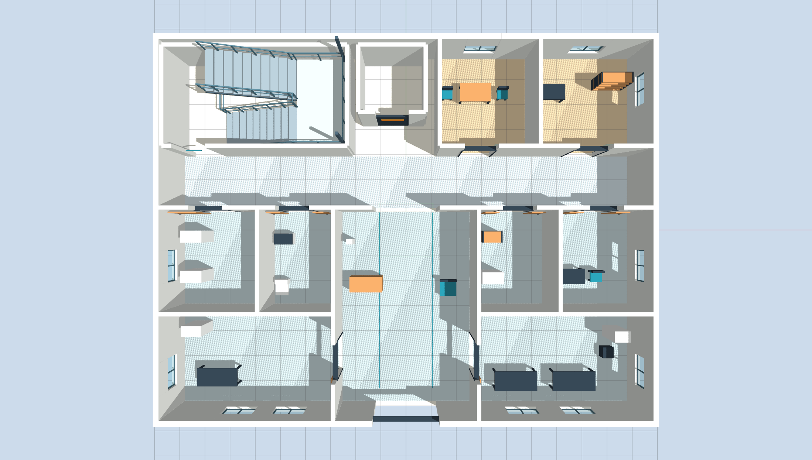
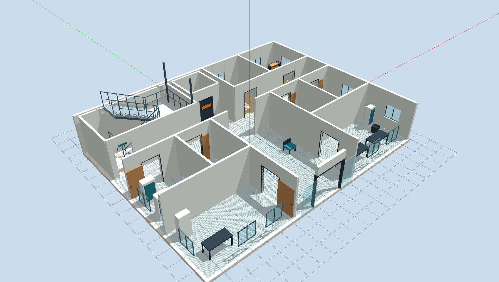
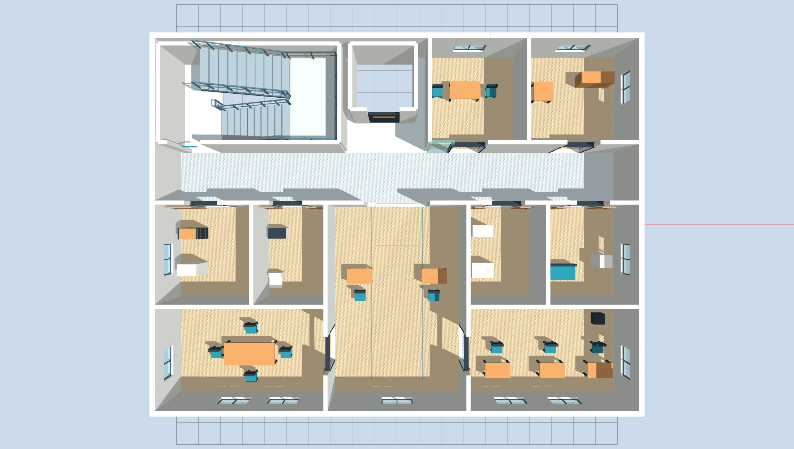
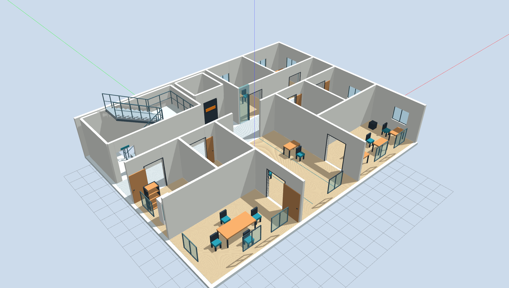
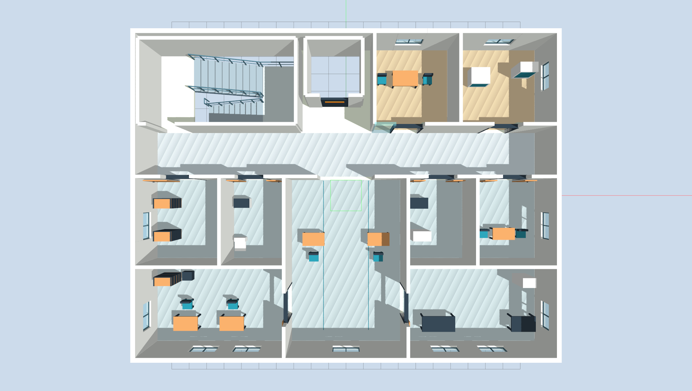
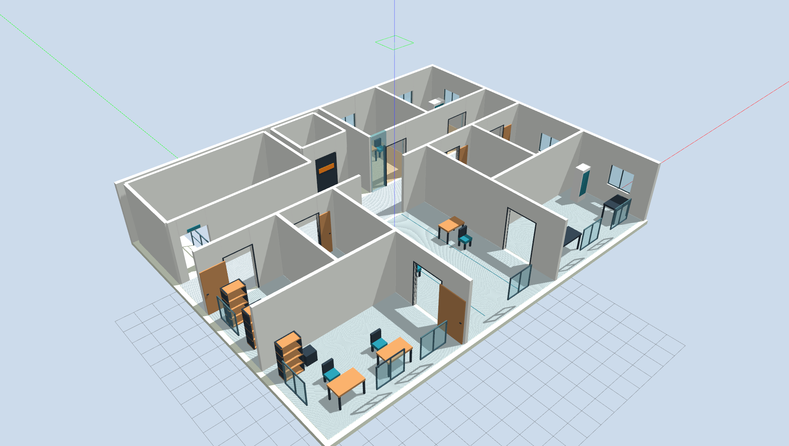
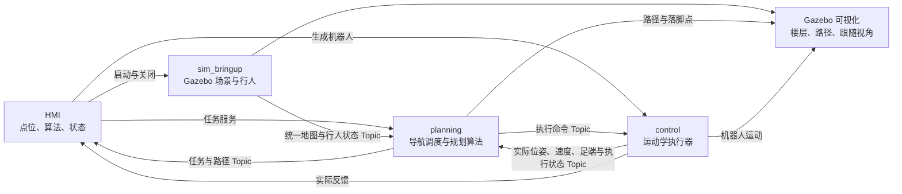
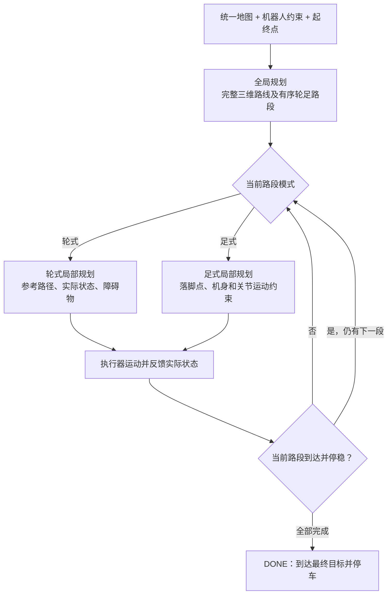

# 三层楼轮足机器人导航仿真

基于 **ROS 2 Humble、Gazebo Classic 11、C++17 和 Python** 的导航仿真项目。在三层楼中生成轮足机器人，选择起终点和规划算法，观察全局路径、局部轨迹、楼梯通行及实际执行结果。

项目用于研究和对比全局、轮式局部、足式局部规划算法。机器人采用理想运动学执行，保留几何碰撞、地面支撑和运动约束；不包含动力学平衡、力矩控制、SLAM 或传感器定位。

[场景与截图](#场景与截图) · [快速启动](#快速启动) · [HMI 使用](#hmi-使用) · [系统架构](#系统架构) · [源码与算法接口](#源码与算法接口) · [当前状态](#当前状态)


## 场景与截图

三层楼包含房间、走廊、门窗、家具、连续双跑楼梯及三名行人。楼层地面高度为 **0、3.2、6.4 m**，楼梯连接相邻楼层，平台转向保持足式模式。

### 三层同屏



同屏视图用于同时观察三个楼层。显示中的楼层展开、隐藏及透明度变化只影响画面，物理场景保持原位。

### 各层俯视与内部透视

| 楼层 | 俯视图 | 内部透视图 |
|---|---|---|
| 一层 |  |  |
| 二层 |  |  |
| 三层 |  |  |

图片位于 [doc/f2](doc/f2)，可点击查看原图。以上为既有场景展示截图，同屏图中的行人路线和标记属于历史配置，当前物理场景与巡逻路线以 [three_floor.world](sim_ws/src/sim_bringup/worlds/three_floor.world) 为准；截图不作为当前导航任务通过的依据。

## 快速启动

### 1. 启动容器

现有容器基于 Ubuntu 22.04。宿主机需要 Docker Engine、Compose V2、NVIDIA 驱动和 Container Toolkit；图形界面使用 X11。GPU、显示和挂载配置见 [compose.yaml](docker/compose.yaml)，依赖见 [Dockerfile](docker/Dockerfile)。

在宿主机图形终端执行：

```bash
cd /home/hfun/norin/lab/simulation
xhost +si:localuser:root
docker compose -f docker/compose.yaml up -d --build
docker compose -f docker/compose.yaml exec dev bash
```

项目挂载到容器 `/workspace`。日常启动可省略 `--build`；已运行的容器可直接进入：

```bash
docker exec -it hfun-navi-simulation-dev-1 bash
```

### 2. 构建并打开 HMI

在容器内执行：

```bash
source /opt/ros/humble/setup.bash
cd /workspace/sim_ws
colcon build --packages-up-to hmi --cmake-args -DCMAKE_BUILD_TYPE=Release
source install/setup.bash
ros2 run hmi panel
```

后续每次打开新容器终端，加载环境即可运行：

```bash
source /opt/ros/humble/setup.bash
source /workspace/sim_ws/install/setup.bash
ros2 run hmi panel
```

## HMI 使用

<p align="center">
  
</p>

既有界面截图展示了场景、机器人点位、三类算法、视角及消息框。Gazebo 在独立窗口显示，图中的任务日志属于当时会话。

### 操作顺序

1. **启动场景**：选择“三层楼”和倍率，点击“启动仿真”，等待就绪。
2. **生成机器人**：选择出生点、目标点，核对坐标后点击“生成机器人”，等待实际位姿和执行器反馈。
3. **开始任务**：分别选择全局、轮式局部、足式局部算法，点击“开始任务”。当前实现为 `A* / TEB / Footstep`。
4. **观察运行**：选择俯视、内部透视、三层同屏，或点击“跟随机器人”。俯视与透视配合楼层选择使用；“恢复所选视角”退出跟随。
5. **查看结果**：消息框显示阶段和原因。`DONE` 表示实际到达并停稳，`WAIT_OBSTACLE` 表示等待，`FAILED` 表示任务失败。
6. **停止或关闭**：“停止任务”取消本次计算或运动；“关闭仿真”结束整个会话。更换出生点时先移除机器人再生成。

三层任务可选正常或 5 倍目标倍率，10 倍用于场景观察；目标倍率不等于实际运行倍率。任务运行时冻结点位与算法选择。中途停止保持实际姿态，不自动收腿或续跑。

### 预设点位

| 楼层 | 点位 | 位置 |
|---|---|---|
| F1 | `F1-ENTRY` | 大门内侧入口安全区 |
| F1 | `F1-STAIR` | 楼梯口前 |
| F1 | `F1-ROOM` | 右上角房间内 |
| F2 | `F2-STAIR` | 楼梯口前 |
| F2 | `F2-ROOM` | 右下角房间内 |
| F2 | `F2-EAST` | 走廊最右端 |
| F3 | `F3-STAIR` | 楼梯口前 |
| F3 | `F3-EAST` | 走廊最右端 |
| F3 | `F3-WINDOW` | 中间下方窗前 |

点位位于 `scene.yaml` 的 `presets.three_floor.points`，坐标为地面 `x, y, z, yaw`，单位为米和弧度。9 个点支持提交任意不同起终点，共 72 个有向组合；开放请求不代表全部组合已通过实际运行验收。

HMI 使用 `ROS_DOMAIN_ID=91`、Gazebo master `http://127.0.0.1:11355`，独立管理自己的会话。更多操作见 [HMI 说明](sim_ws/src/hmi/README.md)。

## 系统架构

| 功能包 | 职责 | 启动入口 |
|---|---|---|
| `sim_bringup` | World、场景地图、行人控制、场景可视化 | `scene.launch.py` |
| `planning` | 全局／轮式／足式算法、导航任务与路段调度 | `planning.launch.py` |
| `control` | 机器人模型、生成、运动学执行及实际状态反馈 | `control.launch.py` |
| `hmi` | 场景、点位、算法选择、进程管理与消息展示 | `ros2 run hmi panel` |



场景端初始化时从实际加载的 World 提取地图并持久发布，规划端接收后使用，普通换任务不重新解析 World。控制执行器和行人控制器是 Gazebo 插件；规划算法本身不处理 ROS 通信或模型移动。

### 导航流程



全局规划决定轮足路段，不按“同层／跨层”分成两套任务流程。楼梯和中间平台全程足式，到楼梯出口停稳后切回轮式。不可执行时停车等待或重规划，超时及保护失败会报告原因。

### 关键通信接口

| 接口 | 类型与用途 |
|---|---|
| `/scene/map` | 地图 Topic：支撑面、静态几何、楼梯连接、行人路线及版本 |
| `/scene/pedestrians` | 行人实际位姿和速度 Topic |
| `/planning/set_task` | 任务服务：起终点和三类算法 |
| `/planning/algorithms` | 服务：查询可选算法 |
| `/planning/plan`、`/planning/execute`、`/planning/stop` | 规划、执行、停止请求服务 |
| `/planning/global_path`、`/planning/local_path` | 全局与局部路径 Topic |
| `/planning/task_status` | 任务阶段、结果和原因 Topic |
| `/robot/execution_command` | 带任务标识、路段、序号及期限的执行命令 Topic |
| `/robot/odom`、`/robot/foot_feedback`、`/robot/execution_status` | 实际位姿、足式状态及执行反馈 Topic |

持续数据通过 Topic 传递，提交任务等一次性操作使用 Service。服务返回成功表示请求被接受，最终完成以任务状态和实际反馈为准。

## 源码与算法接口

```text
simulation/
├── README.md
├── docker/                            # 镜像与运行环境
├── doc/f2/                            # 三层场景和 HMI 图片
└── sim_ws/src/
    ├── sim_bringup/
    │   ├── config/scene.yaml           # 场景、机器人、点位、执行参数
    │   ├── launch/scene.launch.py
    │   ├── worlds/three_floor.world
    │   └── src/                       # 地图提取、行人控制、场景显示
    ├── planning/
    │   ├── config/planning.yaml        # 算法参数、运动约束、计算预算
    │   ├── launch/planning.launch.py
    │   ├── include/                   # 公共输入输出和算法接口
    │   ├── msg/、srv/                 # ROS 消息与服务定义
    │   └── src/
    │       ├── planning_node.cpp       # ROS 节点入口
    │       ├── navigator.cpp           # 任务调度与路段推进
    │       ├── planner_api.cpp         # 算法注册与公共调用
    │       ├── geometry.cpp            # 公共几何与碰撞计算
    │       ├── motion.cpp              # 公共运动与轨迹插值
    │       ├── scene_data.cpp          # 行人预测及几何转换
    │       ├── global/astar.cpp
    │       └── local/
    │           ├── wheel/teb_optimizer.cpp
    │           └── foot/footstep_planner.cpp
    ├── control/
    │   ├── launch/control.launch.py
    │   ├── urdf/robot.urdf.xacro
    │   └── src/robot_executor.cpp      # 轨迹跟随、轮足切换和状态反馈
    └── hmi/hmi/
        ├── app.py                     # 界面
        ├── coordinator.py             # 用户任务协调
        ├── session.py                 # 会话进程管理
        ├── ros_bridge.py              # ROS 通信
        └── presets.py                 # 预设点位与放置配置
```

### 配置与扩展

| 文件 | 管理内容 |
|---|---|
| [scene.yaml](sim_ws/src/sim_bringup/config/scene.yaml) | 机器人尺寸、执行参数、三层楼描述和预设点 |
| [planning.yaml](sim_ws/src/planning/config/planning.yaml) | 算法选择、算法专属参数、公共运动约束和任务预算 |
| [three_floor.world](sim_ws/src/sim_bringup/worlds/three_floor.world) | 实体场景与行人速度、端点、停顿、启动延迟 |
| [robot.urdf.xacro](sim_ws/src/control/urdf/robot.urdf.xacro) | 机器人连杆、关节、碰撞及执行插件 |

全局公共接口和数据结构位于 [global_planner.h](sim_ws/src/planning/include/global_planner.h)，轮式与足式公共接口位于 [local_planner.h](sim_ws/src/planning/include/local_planner.h)。新增算法分别放入 `src/global/`、`src/local/wheel/` 或 `src/local/foot/`，实现对应接口，在 `planner_api.cpp` 注册，并更新 CMake 和算法参数。HMI 从后端查询算法列表，执行器消费统一结果。

技术栈分工：**C++17** 实现规划与 Gazebo 插件；**Python / PyQt5** 实现 HMI 与启动组织；**ROS 2** 提供通信；**Ceres** 求解 TEB；**URDF/Xacro、YAML、colcon/CMake** 管理模型、配置和构建。

## 命令行与结果

容器终端先加载环境。单独观察场景：

```bash
source /opt/ros/humble/setup.bash
source /workspace/sim_ws/install/setup.bash
export ROS_DOMAIN_ID=73
export GAZEBO_MASTER_URI=http://127.0.0.1:11345

# 整体场景
ros2 launch sim_bringup scene.launch.py scene:=three_floor

# 退出上一个场景后，三层同屏，以目标 5 倍速观察
ros2 launch sim_bringup scene.launch.py scene:=three_floor view:=split real_time_factor:=5

# 退出上一个场景后，查看二层内部；俯视改为 view:=top
ros2 launch sim_bringup scene.launch.py scene:=three_floor floor:=2 view:=interior
```

三个 launch 各自管理场景、机器人和规划。命令行运行机器人任务时，`control` 与 `planning` 必须接收同一份三层任务快照 `scene_file`，并与场景使用同一 ROS 域和 Gazebo master；快照包含出生点、目标点以及实际 `runtime.world` 路径。日常操作使用 HMI 自动生成和管理这些配置。

执行隔离诊断可用两个独立开关：场景的 `pedestrians_paused:=true` 将行人固定在各自初始端点，保留实体与碰撞；规划的 `wheel_execution:=global_path` 关闭轮式局部规划，直接跟随全局路点，楼梯仍使用足式规划。默认分别为 `false` 和 `local`，HMI 暂无这两个开关。

| 结果 | 位置或用途 |
|---|---|
| HMI 会话 | `~/.local/state/hmi/<时间>/`：运行 World、配置、进程日志和规划结果 |
| CLI 会话 | 默认 `~/.local/state/simulation/`；可用 `output_dir` / `results_dir` 指定 |
| `task_result.csv` | 最终状态、原因、到达误差、耗时及停车速度 |
| `task_events.csv` | 阶段切换和关键事件 |

`~` 为容器用户目录。需要长期保存的结果应复制到宿主机或挂载目录。`sim_ws/{build,install,log,results}` 是 Git 忽略的本地产物。修改源码或安装资源后需重新构建、加载环境并重启相关进程。

查询 HMI 当前任务，在另一个已加载环境的容器终端执行：

```bash
export ROS_DOMAIN_ID=91
ros2 topic echo /planning/task_status std_msgs/msg/String --once \
  --qos-durability transient_local --qos-reliability reliable
```

## 当前状态

主体架构和通信链路已接通，算法通过统一接口调用。当前实际验证范围如下：

| 项目 | 状态 |
|---|---|
| 三层场景、机器人生成与可视化 | 已实现 |
| 三维全局路径与轮足路段输出 | 已实现 |
| 暂停行人、直接跟随全局路径跨层 | 一层入口 → 二层房间已实际到达并停稳 |
| 暂停行人、TEB 同层任务 | 二层楼梯口 → 走廊右端已实际到达并停稳 |
| 暂停行人、TEB 跨层任务 | 有到达记录，也有转角停滞记录，稳定性待解决 |
| 行人运动下的动态通行 | 尚未完成稳定验收 |
| 足式速度 | 已按机身、足端和关节限制调整步时，仍有速度优化需求 |

电梯控制未开发。当前结果不代表所有点对或动态场景均已通过；后续算法对比应在相同地图、机器人约束和任务条件下进行。
