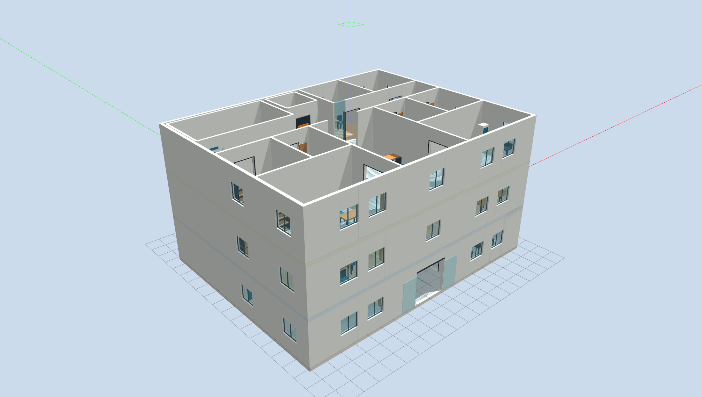
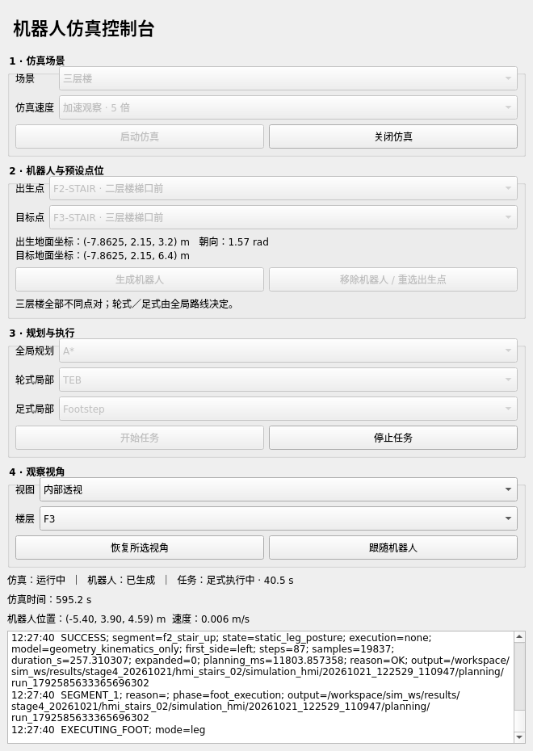
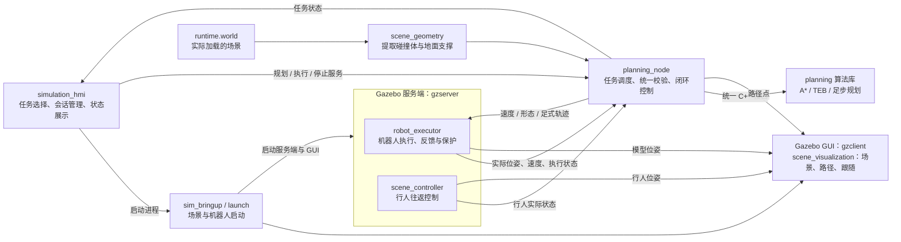
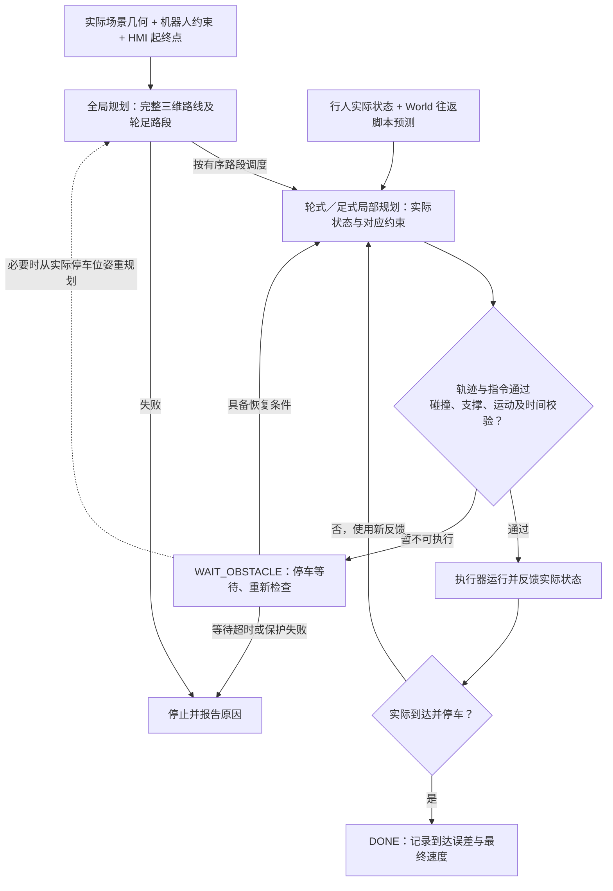

# 轮足机器人导航仿真

基于 **ROS 2 Humble + Gazebo Classic 11** 的轮足机器人导航仿真项目。提供场景与动态障碍物、图形控制台（HMI）、全局与局部规划、机器人执行及结果记录，用于验证导航闭环，并为替换规划算法、比较运行结果提供统一接口。

[快速启动](#快速启动) · [技术栈](#技术栈) · [系统架构](#系统架构) · [核心流程](#核心流程) · [开发与验证](#开发与验证)

## 项目定位

| 输入 | 处理 | 输出 |
|---|---|---|
| World 场景、机器人模型、起终点、规划与运动参数 | 场景几何提取 → 全局规划 → 局部规划 → 执行与反馈 | 规划路径、实际运动、任务状态、轨迹与结果记录 |

当前支持两种场景：

| 场景 | 已实现能力 | 运行入口 |
|---|---|---|
| 两级台阶 `two_steps` | A→E 轮式绕障、E→X 足式上台阶、X→B 轮式到达停车 | HMI 选择 A→B，或命令行自动任务 |
| 三层楼 `three_floor` | 统一三维路线、轮式动态避障、楼梯及平台全程足式 | HMI 选择9个预设点中的任意不同起终点 |

当前采用 **运动学执行**，验证轨迹、碰撞和地面支撑，不包含动力学平衡、接触力或电机力矩控制。导航使用已知场景与仿真实际状态，不包含 SLAM 或传感器定位。 **当前第四阶段验收未通过：约定真实路线8/9到达，F2-ROOM→F2-EAST因动态等待超时；静态检查停在35/72，待确认修复方案。**三层楼通过统一接口组织同层、上下楼与连续跨两层任务；电梯未开发。机器人已增加左右髋部偏航关节，用于平台足式迈步转向。



[两级台阶完整任务录像（1.5 倍速）](doc/f1/task-full-1.5x.mp4) · [三层楼正式图片](doc/f2)（各层俯视、内部透视及整体视图）。这些是既有演示素材，同屏图片中的行人路线属于历史配置，当前路线以 World 为准。

## 快速启动

### 1. 启动并进入容器

当前容器环境为 Ubuntu 22.04、ROS 2 Humble、Gazebo Classic 11。宿主机需安装 Docker Engine、Compose V2、NVIDIA 驱动与 Container Toolkit，并提供 X11 图形桌面；现有 Compose 使用 `gpus: all`。

在**宿主机图形桌面终端**执行，项目放在其他位置时替换第一行路径：

```bash
cd /home/hfun/norin/lab/simulation
xhost +si:localuser:root
docker compose -f docker/compose.yaml up -d --build
docker compose -f docker/compose.yaml exec dev bash
```

项目目录挂载到容器 `/workspace`。日常使用无需重新构建镜像，将 `up -d --build` 改为 `up -d`；已有容器也可用 `docker exec -it hfun-navi-simulation-dev-1 bash` 进入。

### 2. 构建并启动 HMI

在**容器内**执行：

```bash
source /opt/ros/humble/setup.bash
cd /workspace/sim_ws
colcon build --packages-up-to simulation_hmi \
  --cmake-args -DCMAKE_BUILD_TYPE=Release -DBUILD_TESTING=OFF
source install/setup.bash
ros2 launch simulation_hmi hmi.launch.py
```

已完成构建后，每个新容器终端只需加载环境并启动：

```bash
source /opt/ros/humble/setup.bash
source /workspace/sim_ws/install/setup.bash
ros2 launch simulation_hmi hmi.launch.py
```

### 3. HMI 界面与操作



上图采自5倍实际任务：分别选择全局、轮式局部、足式局部算法，一个“开始任务”串接规划与执行；Gazebo 在独立窗口显示。

| 界面区域 | 用途与操作 |
|---|---|
| **1 · 仿真场景** | 选择两级台阶／三层楼及倍率；“启动仿真”创建会话，“关闭仿真”结束整套会话。更换场景或倍率需先关闭仿真 |
| **2 · 机器人与预设点位** | 选择出生点、目标点，核对下方地面坐标与朝向，再“生成机器人”；重选出生点使用“移除机器人 / 重选出生点” |
| **3 · 规划与执行** | 独立选择三类算法；“开始任务”自动规划并执行；“停止任务”取消计算或运动并停车 |
| **4 · 观察视角** | 总览看整体，俯视／内部透视配合楼层选择，三层同屏同时观察各层；“跟随机器人”启用第三人称宽视野，“恢复所选视角”退出跟随 |
| **底部状态与消息框** | 查看实际仿真时间、机器人位置、任务状态与失败原因；按钮不可用时，先检查是否就绪、点位组合及倍率是否受支持 |

以三层楼一层任务为例：

1. 选择“三层楼”和“正常速度 · 1 倍”，点击“启动仿真”，等待场景就绪。
2. 出生点选 `F1-ENTRY`、目标点选 `F1-ROOM`，点击“生成机器人”，等待实际位置和执行器就绪。
3. 选择全局 `A*`、轮式 `TEB`、足式 `Footstep`，点击“开始任务”。全局就绪后显示路线，局部按实际状态分段求解并执行。
4. 在消息框观察阶段及墙钟耗时。`WAIT_OBSTACLE` 表示正在安全等待行人，条件允许后自动恢复；`DONE` 表示完成并停车，`FAILED` 需查看原因。
5. 观察时可选“俯视 + F1”或“跟随机器人”。需要中止时点“停止任务”。完成后可从实际终点选择下一个目标；重新开始仍检查实际停稳、轮式状态及选定起点，不自动恢复足式中途停止。结束使用时点“关闭仿真”。

两级台阶保留 **A→B**；三层楼可选择9个预设点中的任意不同起终点。楼梯和平台全程足式，平地轮式，由全局结果决定。同层／跨层变化不要求重生；实际不在选定起点时须重选真实起点或移除重生。任务计算与执行期间冻结点位、算法与参数；新选择只用于下一任务。

首次建议运行 **两级台阶 A→B，正常速度**，或 **三层楼 F1-ENTRY→F1-ROOM，正常速度**。三层同层闭环支持正常／5 倍目标倍率，10 倍仅用于场景观察；两级台阶闭环使用正常速度。目标倍率不代表实际达到的倍率。

HMI 使用独立的 `ROS_DOMAIN_ID=91`、Gazebo master `http://127.0.0.1:11355`；Compose 普通终端默认域为 `73`。另开终端查询 HMI 的 ROS 状态时，先执行 `export ROS_DOMAIN_ID=91`。面板不接管已有命令行仿真。点位、界面操作与会话参数详见 [HMI 使用说明](sim_ws/src/simulation_hmi/README.md)。

### 命令行入口

以下命令在容器中加载环境后，按需单独运行，切换前用 `Ctrl+C` 退出旧实例。

```bash
# 默认观察三层楼，不加载机器人
ros2 launch sim_bringup simulation.launch.py

# 三层同屏，目标 5 倍速度
ros2 launch sim_bringup simulation.launch.py view:=split real_time_factor:=5

# 第二层内部透视；俯视使用 view:=top
ros2 launch sim_bringup simulation.launch.py floor:=2 view:=interior

# 两级台阶完整自动任务：规划、轮足切换、执行、停车
ros2 launch sim_bringup simulation.launch.py scene:=two_steps robot:=true \
  planning:=true local_planning:=true foot_planning:=true autonomous:=true
```

总入口默认 `scene:=three_floor robot:=false`，三层使用 `robot:=true` 时须通过 `scene_file:=...` 提供与当前 World 对应的任务快照。三层导航由 HMI 生成任务快照，再启动机器人与规划节点。查看入口参数可执行 `ros2 launch sim_bringup simulation.launch.py --show-args`；无界面运行可加 `gui:=false`。

## 技术栈

| 类别 | 核心技术 | 职责 |
|---|---|---|
| 语言 | C++17、Python 3 | 规划库与 Gazebo 插件；HMI、任务配置与启动组织 |
| 通信 | ROS 2 Humble：rclcpp、rclpy、Launch | 任务服务、指令、实际反馈及进程启动 |
| 仿真与模型 | Gazebo Classic 11、Gazebo ROS、URDF/Xacro | 场景、模型、碰撞、机器人生成及运动学执行 |
| 规划算法 | A*、TEB、足步 A* 与五次轨迹 | 全局路径、轮式局部轨迹、足式落脚与身体轨迹 |
| 数值优化 | Ceres | TEB 非线性轨迹优化 |
| 界面与显示 | PyQt5、Qt5、Gazebo 渲染接口 | HMI、场景剖视、路径绘制与机器人跟随 |
| 配置与构建 | YAML / yaml-cpp、colcon、CMake、ament | 场景及算法参数、ROS 包构建与安装 |
| 环境 | Docker、Compose、NVIDIA / X11 | 开发环境与图形仿真运行 |

依赖安装见 [Dockerfile](docker/Dockerfile)，GPU、显示、挂载与通信域配置见 [compose.yaml](docker/compose.yaml)。

## 系统架构

系统分为操作、导航、算法、仿真执行与显示。`planning` 是独立 C++ 算法库；`planning_node` 是调用它的 ROS 节点；执行器和场景控制器是加载到 Gazebo 服务端的插件。



| 模块 | 职责与边界 |
|---|---|
| `simulation_hmi` | 选择场景与预设点、生成任务快照、管理会话进程、调用服务并展示反馈；不实现规划算法 |
| `planning_node.cpp` | 装配几何与算法参数、组织任务、校验规划结果、跟踪轨迹、等待／重规划、记录结果 |
| `planning` | 通过全局、轮式局部、足式局部三类接口输出结果；不读取 World、不操作机器人、不依赖 ROS |
| `scene_geometry.cpp` | 三层任务从实际加载的 World 提取碰撞体、旋转朝向和楼板支撑；楼梯洞不能作为平地 |
| `robot_executor.cpp` | 在 gzserver 内执行运动与轮足形态切换，发布实际反馈并保留独立保护；不能独立 `ros2 run` |
| `scene_controller.cpp` | 按 World 参数控制三名行人往返；保留真实碰撞，不依赖 GUI |
| `scene_visualization.cpp` | 楼层显示、剖视、三层同屏、路径与跟随；隐藏或平移楼层只影响显示，物理世界保持原位 |

## 核心流程

### 启动与任务准备

HMI 启动后，用户选择场景，`scene.launch.py` 生成 `runtime.world` 并启动 Gazebo。选择起终点后，面板根据公共配置生成 `robot_scene.yaml` 任务快照，`robot.launch.py` 展开机器人模型、核对轮式几何并生成机器人；规划节点通过实际时钟、里程计与执行器状态确认就绪。

三层任务从当前会话的 `runtime.world` 提取几何，`scene.yaml` 保存公共机器人与任务配置，不重复录入三层家具坐标。两级台阶沿用配置中的已知几何与 A/E/X/B 路段。

### 三层统一导航闭环



行人不主动让行。机器人在冲突前检查通行时序，不能安全执行时先停车；反馈失效或预测过期时不沿用旧轨迹。用户停止终止本次任务，晚到的规划结果不会恢复运动。动态障碍信息来自仿真反馈与已知往返脚本，不是传感器感知。

两级台阶的任务流程为 **A→E 轮式 → 展腿 → E→X 足式 → 收腿 → X→B 轮式停车**。三层楼按全局输出遍历任意数量路段，每个足式段独立生成，平台转向不切回轮式。

### 关键接口

| 接口 | 用途 |
|---|---|
| `/planning/plan`、`/planning/execute`、`/planning/stop` | HMI 规划、执行、停止服务，类型为 `std_srvs/srv/Trigger`，仅交互模式启用 |
| `/planning/global_path`、`/planning/local_path` | 全局与局部规划输出，类型为 `nav_msgs/msg/Path` |
| `/planning/task_status` | 任务阶段、终态、原因及结果目录 |
| `/robot/cmd_vel`、`/robot/mode_command`、`/robot/foot_trajectory` | 轮式速度、形态／停止指令、足式执行轨迹 |
| `/robot/odom`、`/robot/foot_feedback`、`/robot/execution_status` | 实际位姿与速度、足式反馈、执行器状态 |
| `/clock` | 仿真时间；ROS 节点使用 `use_sim_time` |

规划路径表示“准备怎么走”，实际轨迹来自执行器反馈。GUI 对位姿做约 100 ms 的显示插值并同步跟随相机，路径使用轻量线条绘制；这些显示处理不改变控制反馈或碰撞判定。

## 开发与验证

### 源码目录与入口

```text
simulation/
├── README.md
├── docker/                         # Dockerfile、Compose 环境
├── doc/
│   ├── f1/                         # 两级台阶演示素材与历史离线手册
│   ├── f2/                         # 三层楼正式场景图片
│   └── prd_navigation.md           # 后续四包重构范围与分阶段要求
└── sim_ws/src/
    ├── planning/                   # 独立 C++ 算法库
    │   ├── include/                # 全局、轮式局部、足式局部接口与实现声明
    │   ├── src/global/             # A* 全局规划
    │   ├── src/local/wheel/        # TEB 轮式局部规划
    │   ├── src/local/foot/         # 足步与身体轨迹规划
    │   └── test/                   # 算法与接口测试
    ├── sim_bringup/
    │   ├── launch/                 # simulation 总入口、scene 场景、robot 机器人
    │   ├── config/                 # scene.yaml、planning.yaml
    │   ├── worlds/                 # two_steps.world、three_floor.world
    │   ├── urdf/                   # robot.urdf.xacro
    │   └── src/                    # 规划调度、几何适配、机器人执行与场景插件
    └── simulation_hmi/
        ├── launch/                 # hmi.launch.py
        ├── config/                 # presets.yaml 预设点位
        ├── simulation_hmi/         # app、session、ros_bridge、presets
        └── test/                   # 点位与会话管理测试
```

`simulation.launch.py` 组合场景与可选机器人；`scene.launch.py` 单独启动场景；`robot.launch.py` 向已有服务端加载机器人。分开启动时，场景与机器人须共用 `master_uri` 和 `ROS_DOMAIN_ID`。HMI 入口只启动面板，由按钮启动本次仿真。

### 关键配置与算法替换

| 文件 | 修改内容 |
|---|---|
| [planning.yaml](sim_ws/src/sim_bringup/config/planning.yaml) | `planners` 选择算法与计算预算；`motion` 为公共运动约束；`teb`、`foot` 为算法参数；`task` 为原任务执行约束 |
| [scene.yaml](sim_ws/src/sim_bringup/config/scene.yaml) | 公共机器人几何、原台阶任务；`scenes.three_floor` 为楼层高度、同层到达标准与等待预算 |
| [presets.yaml](sim_ws/src/simulation_hmi/config/presets.yaml) | 两级台阶四个点、三层楼九个点；坐标为 `[x, y, 地面z, yaw]`，单位 m / rad |
| [three_floor.world](sim_ws/src/sim_bringup/worlds/three_floor.world) | 三层物理场景；三个 `pedestrian_patrol` 插件配置行人端点、速度、启动延迟与停顿 |
| [two_steps.world](sim_ws/src/sim_bringup/worlds/two_steps.world) | 原台阶、平台与障碍，修改时同步原任务几何配置 |
| [robot.urdf.xacro](sim_ws/src/sim_bringup/urdf/robot.urdf.xacro) | 机器人连杆、关节、碰撞及执行插件；修改时同步规划几何与运动约束 |

算法契约见 [global_planner.h](sim_ws/src/planning/include/global_planner.h)、[local_planner.h](sim_ws/src/planning/include/local_planner.h)。当前实现为 `astar`、`teb`、`footstep`。新增算法需实现相应接口、加入工厂创建与构建项，再通过 `planning.yaml` 选择；HMI分别选择三类现有算法，不提供运行时插件加载。公共 `runPlanner` 对足式结果执行有限值、时间、端点等轻量检查；算法保留候选约束，执行器保留实时保护。整段足式密集独立校验仅在显式验收入口运行，控制流程通过抽象接口调用。

比较算法时固定场景、起终点、机器人几何、公共约束、仿真倍率及行人初始相位，比较耗时、实际路程、到达误差和失败原因；算法内部优化代价不作为通用评分。

修改源码、配置、模型或 World 后，在容器内重新构建，再加载环境并重启相关进程：

```bash
source /opt/ros/humble/setup.bash
cd /workspace/sim_ws
colcon build --packages-up-to simulation_hmi \
  --cmake-args -DCMAKE_BUILD_TYPE=Release -DBUILD_TESTING=OFF
source install/setup.bash
```

运行读取安装目录中的资源，编辑源文件不会自动刷新现有进程；场景与运动约束在规划节点启动时固定；三类算法名称只允许空闲时原子更新，任务中冻结，未知名称明确拒绝。

### 验证与结果

容器内运行现有算法及 HMI 测试：

```bash
source /opt/ros/humble/setup.bash
cd /workspace/sim_ws
colcon build --packages-up-to simulation_hmi \
  --cmake-args -DCMAKE_BUILD_TYPE=Release -DBUILD_TESTING=ON
source install/setup.bash
colcon test --packages-select planning simulation_hmi
colcon test-result --verbose
```

当前代码是四包重构前的版本：已接通统一全局导航、三类算法选择、单按钮任务、自适应足式步时及落脚点显示，仍有 F2-ROOM→F2-EAST 动态等待超时问题。历史 build、install、log、results 已按要求清理，原始验收证据不再可复查，运行前需要重新构建。[重构 PRD](doc/prd_navigation.md) 描述后续目标；其中 control、hmi 包和新启动入口尚未实施，本 README 命令仍对应当前代码。

仅复现第一阶段离线检查，在容器中执行（不会初始化 ROS 或移动机器人）：

```bash
source /workspace/sim_ws/install/setup.bash
/workspace/sim_ws/install/sim_bringup/lib/sim_bringup/planning_acceptance \
  --check-global-pairs \
  /workspace/sim_ws/src/sim_bringup/worlds/three_floor.world \
  /workspace/sim_ws/src/simulation_hmi/config/presets.yaml \
  /workspace/sim_ws/src/sim_bringup/config/scene.yaml \
  /workspace/sim_ws/src/sim_bringup/config/planning.yaml \
  /workspace/sim_ws/results/stage1_$(TZ=Asia/Shanghai date +%Y%m%d_%H%M%S)
```

证据输出目录必须不存在，避免覆盖历史记录；打开其中的 `index.html` 查看全部路线，`pairs.csv` 查看逐组合结果。


| 结果位置 / 文件 | 用途 |
|---|---|
| `~/.local/state/simulation_hmi/<时间>/` | HMI 会话目录：运行时 World、任务快照、视角配置、截图、进程日志及 `planning/` 下的规划结果 |
| `~/.local/state/simulation/` | CLI 默认场景观察输出；原任务规划默认位于其 `global_planning/` 下，也可用 `results_dir` 指定 |
| `task_result.csv` | 最终状态、失败原因、到达误差、用时与停车速度 |
| `task_events.csv`、`actual_trajectory.csv` | 阶段切换、实际运动轨迹 |
| `path.csv`、`teb_execution.csv` | 全局路径与闭环局部预测记录；对应模式运行后生成 |

`~` 指启动进程的容器用户目录，当前通常是 `/root`，不在项目挂载中；需长期保留的结果应复制到宿主机或挂载目录。`sim_ws/{build,install,log,results}` 为本地构建／运行产物，已由 Git 忽略。手动中断可能没有最终结果文件。

查询 HMI 状态可在另一个已加载环境的容器终端执行：

```bash
export ROS_DOMAIN_ID=91
ros2 topic echo /planning/task_status std_msgs/msg/String --once \
  --qos-durability transient_local --qos-reliability reliable
ros2 topic echo /robot/odom nav_msgs/msg/Odometry --once
```

| 常见现象 | 优先检查 |
|---|---|
| HMI 或 Gazebo 无法显示 | `DISPLAY`、X11 授权与挂载、NVIDIA 驱动／Toolkit、会话进程日志 |
| 查询不到反馈 | 是否加载正确 overlay、是否与会话使用同一 ROS 域；HMI 默认 91，普通 CLI 默认 73 |
| 修改不生效 | `ros2 pkg prefix --share sim_bringup` 是否指向当前安装；重新构建、source 并重启 |
| 规划或执行失败 | 消息框、`task_result.csv` 的原因、`task_events.csv`；核对碰撞、地面支撑、反馈时效与计算预算 |
| 跨层组合不能规划 | 三层任意不同预设点均可请求；检查实际起点、停止／轮式状态及消息框中的后端失败原因 |

HMI 退出时清理自己创建的会话进程；CLI 用 `Ctrl+C` 退出整套 Launch，关闭 Gazebo 窗口不等于任务停止。重跑使用新会话，不用 Gazebo Reset 代替任务复位。

详细操作见 [HMI 说明](sim_ws/src/simulation_hmi/README.md)，开发范围与阶段结果见 [导航 PRD](doc/prd_navigation.md)。[两级台阶离线手册](doc/f1/simulation-manual.html) 为历史版本，当前入口与能力以本 README 为准。
