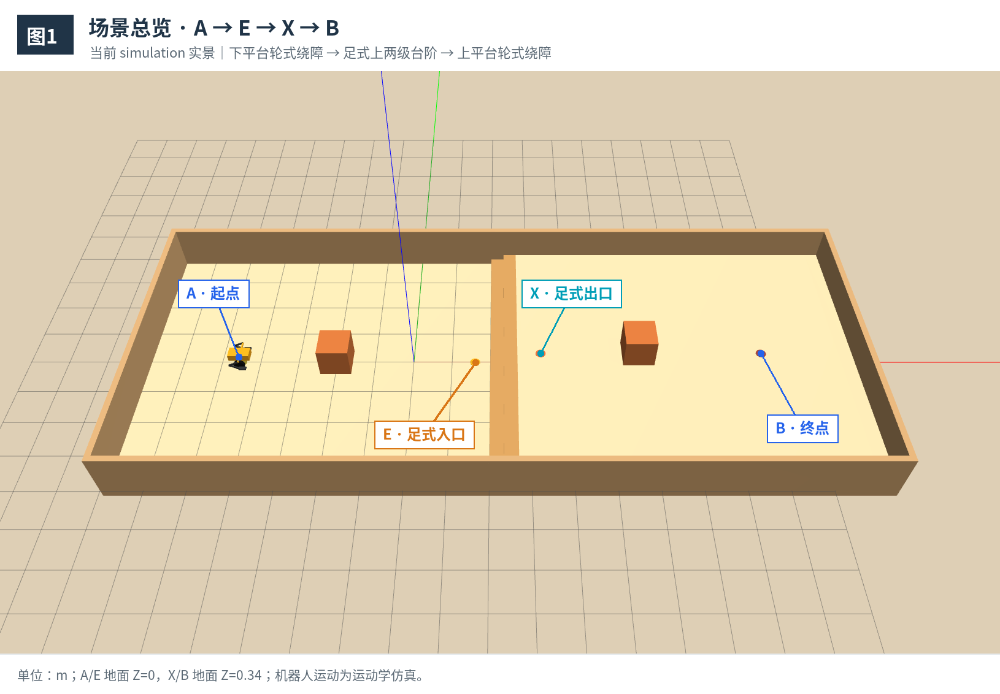
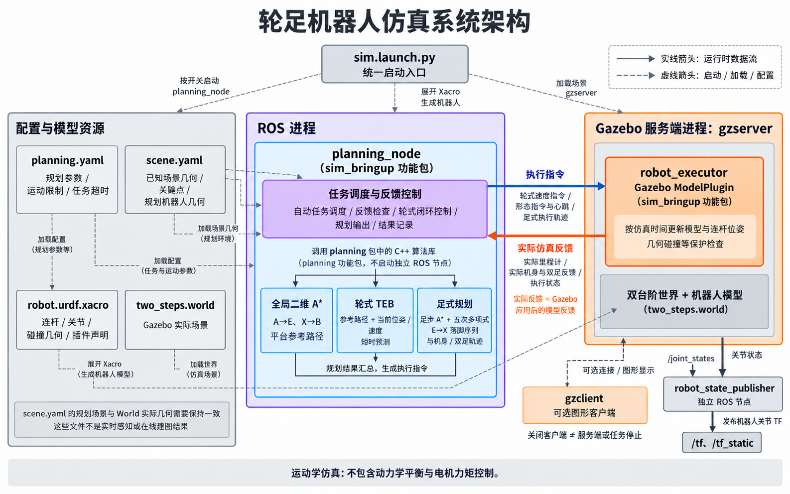
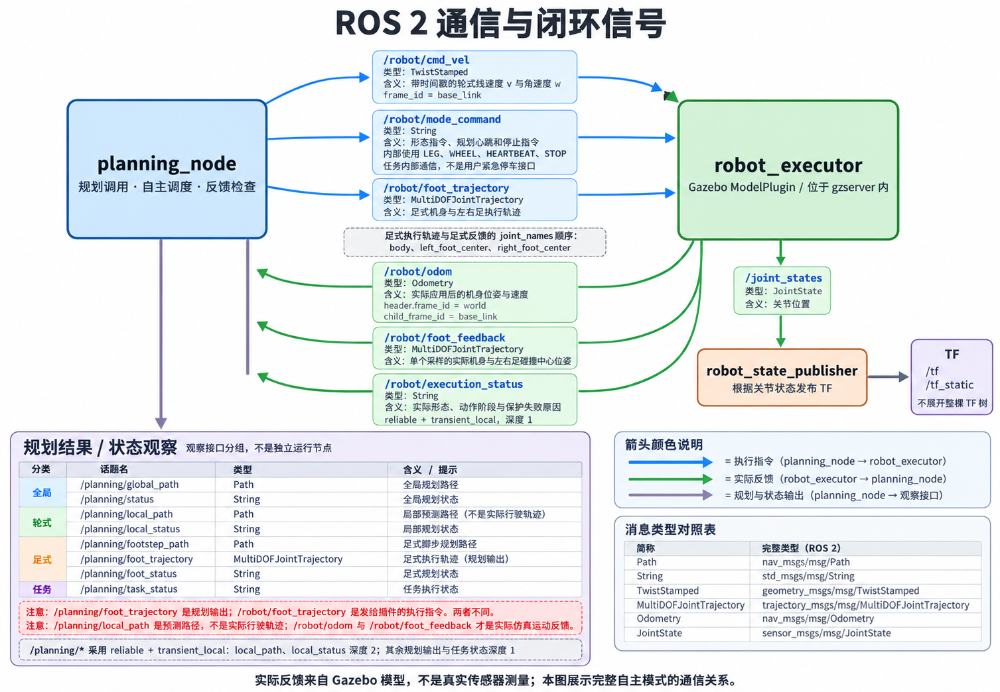
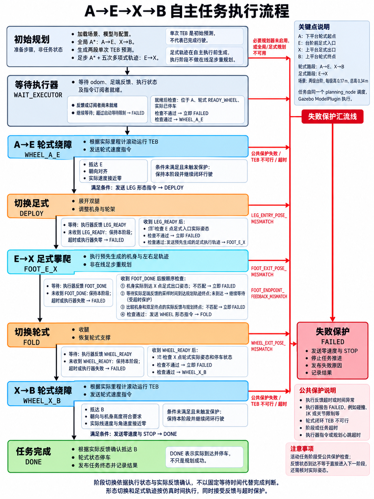
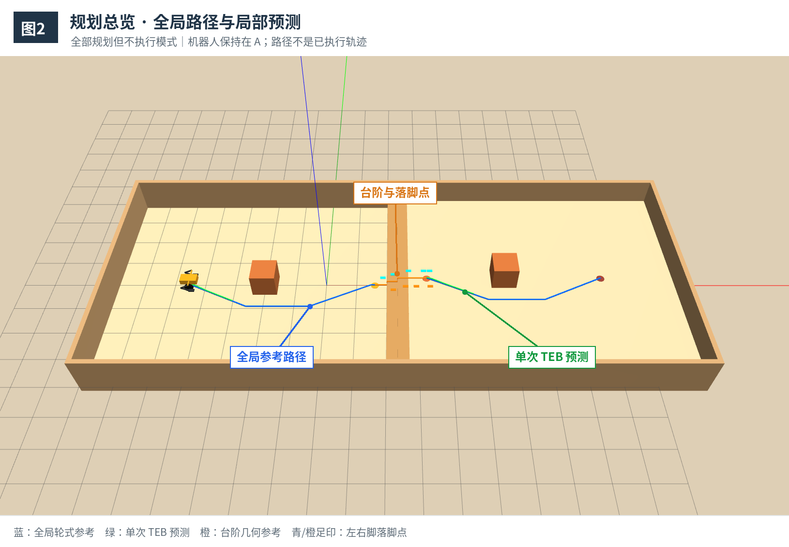
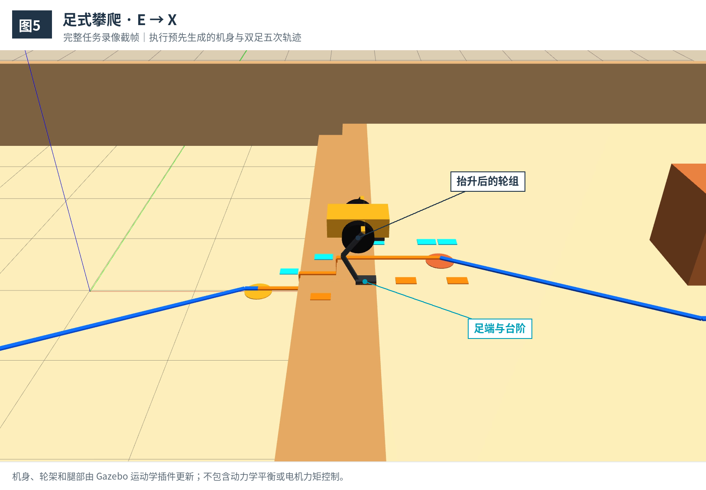

# 轮足机器人仿真：使用与开发手册

ROS 2 Humble · Gazebo Classic · C++17。基于已知场景，完成 **A→E 轮式绕障 → E→X 足式攀爬 → X→B 轮式绕障停车**。

目录：[演示效果](#demo) · [环境与运行](#run) · [模型与 ROS 接口](#interfaces) · [规划与自主任务](#planning) · [参数与开发](#development) · [结果与排查](#diagnostics)

<a id="demo"></a>

## 1. 演示效果

[](doc/task-full-1.5x.mp4)

**[播放完整任务录像：1.5 倍速，约 83 秒](doc/task-full-1.5x.mp4)**。视频连续展示绕障、展腿、上台阶、收腿和到达 B 停车。

当前为 **Gazebo Classic 运动学执行**，不包含动力学平衡、接触力或电机力矩控制。场景、台阶和切换点预先配置，无在线建图或楼梯识别。

<a id="run"></a>

## 2. 环境与运行

### 开发环境

| 项目 | 当前配置 |
|---|---|
| 系统 / ROS / 仿真 | 容器 Ubuntu 22.04、ROS 2 Humble、Gazebo Classic 11；素材采集版本为 11.10.2 |
| 构建与依赖 | C++17、colcon、CMake、Ceres、yaml-cpp、TBB、Gazebo ROS、Xacro、robot_state_publisher |
| 宿主机 | Docker Engine、Compose V2（支持 `gpus: all`）、NVIDIA 驱动与 Container Toolkit、X11 |
| Compose / 容器 | 项目 `hfun-navi-simulation`，服务 `dev`，容器 `hfun-navi-simulation-dev-1` |
| 通信域 | `ROS_DOMAIN_ID=73`，由 Compose 设置；ROS 查询在同一容器内执行 |
| 挂载 | 宿主机 `/home/hfun/norin/lab/simulation` ↔ 容器 `/workspace`，双向可写 |

配置见 [Dockerfile](docker/Dockerfile)、[compose.yaml](docker/compose.yaml)。项目换目录时只替换宿主机路径；镜像未锁定摘要，首次构建的小版本可能不同。

### 首次构建

**宿主机执行**，`xhost` 在图形桌面用户终端运行：

```bash
cd /home/hfun/norin/lab/simulation
xhost +si:localuser:root
docker compose -f docker/compose.yaml up -d --build
docker compose -f docker/compose.yaml exec dev bash
```

**容器内执行**，编译工作空间：

```bash
source /opt/ros/humble/setup.bash
cd /workspace/sim_ws
colcon build --packages-select planning sim_bringup \
  --cmake-args -DCMAKE_BUILD_TYPE=Release -DBUILD_TESTING=OFF
source /workspace/sim_ws/install/setup.bash
```

### 日常启动与新终端

**宿主机执行**：无需重新构建镜像。

```bash
cd /home/hfun/norin/lab/simulation
xhost +si:localuser:root
docker compose -f docker/compose.yaml up -d
docker compose -f docker/compose.yaml exec dev bash
```

<a id="terminal-environment"></a>

**每个新容器终端执行**：后续运行、查询和编译均需先加载环境。

```bash
source /opt/ros/humble/setup.bash
cd /workspace/sim_ws
source /workspace/sim_ws/install/setup.bash
echo "ROS_DISTRO=$ROS_DISTRO ROS_DOMAIN_ID=$ROS_DOMAIN_ID"
```

预期为 `humble`、`73`。

<a id="full-task"></a>

### 运行完整任务

**容器内执行**：启动后自动规划并执行，无需服务调用。

```bash
source /opt/ros/humble/setup.bash
cd /workspace/sim_ws
source /workspace/sim_ws/install/setup.bash
ros2 launch sim_bringup sim.launch.py \
  planning:=true local_planning:=true foot_planning:=true autonomous:=true \
  results_dir:=/workspace/sim_ws/results
```

四个开关必须同时启用，`autonomous` 不会自动打开其他规划。无界面运行在[分模式运行](#modes)中给出；`gui:=false` 不取消当前 Compose 的 GPU 要求。

### 退出与重跑

在启动终端按 `Ctrl+C`，等待整套 Launch 退出，再运行上述命令即可从 A 重来。`gzclient` 只负责显示，关闭窗口不保证 `gzserver` 和任务停止。

当前没有项目级复位服务。自主任务中暂停可能触发反馈超时，重置仿真时间会触发 `SIMULATION_TIME_RESET`；不要用 Gazebo Reset 代替整套重启。中途退出可能没有最终结果文件。

**宿主机执行**：不再使用容器时停止它，挂载数据保留；容器 shell 中的 `exit` 只退出当前终端。

```bash
cd /home/hfun/norin/lab/simulation
docker compose -f docker/compose.yaml stop dev
```

<a id="interfaces"></a>

## 3. 模型与 ROS 接口

[](doc/system-architecture.png)

| 位置 / 组件 | 职责 |
|---|---|
| [planning](sim_ws/src/planning) | 全局 A*、轮式 TEB、足步 A* 与五次轨迹的 C++ 库，不是独立 ROS 节点 |
| [planning_node.cpp](sim_ws/src/sim_bringup/src/planning_node.cpp) | 同一节点调用三类算法，负责自主调度、反馈控制、可视化和结果记录 |
| [robot_executor.cpp](sim_ws/src/sim_bringup/src/robot_executor.cpp) | Gazebo ModelPlugin，加载在 gzserver 内，执行运动、轮足切换与保护；不能独立 `ros2 run` |
| [robot.urdf.xacro](sim_ws/src/sim_bringup/urdf/robot.urdf.xacro) | 连杆、关节、碰撞和插件声明；spawn_entity.py 在 A 生成模型后退出 |
| [two_steps.world](sim_ws/src/sim_bringup/worlds/two_steps.world) | 实际平台、台阶、障碍和围墙 |
| [sim.launch.py](sim_ws/src/sim_bringup/launch/sim.launch.py) | 统一加载资源和节点；robot_state_publisher 根据 joint_states 发布关节 TF |
| `doc/` | 本手册使用的图片与完整演示视频 |

[](doc/ros2-communication-and-feedback.png)

| Topic | 消息类型 | 用途 / 出现条件 |
|---|---|---|
| `/planning/global_path` | `nav_msgs/msg/Path` | 全局路径与台阶参考；planning |
| `/planning/status` | `std_msgs/msg/String` | 全局结果、原因与输出目录；planning |
| `/planning/local_path` | `nav_msgs/msg/Path` | TEB 预测；local_planning |
| `/planning/local_status` | `std_msgs/msg/String` | 单次预测结果或闭环规划状态；local_planning |
| `/planning/footstep_path` | `nav_msgs/msg/Path` | 规划落脚点；foot_planning |
| `/planning/foot_trajectory` | `trajectory_msgs/msg/MultiDOFJointTrajectory` | 规划机身与双足轨迹；foot_planning |
| `/planning/foot_status` | `std_msgs/msg/String` | 足式规划结果；foot_planning |
| `/planning/task_status` | `std_msgs/msg/String` | 任务阶段、终态和原因；autonomous |
| `/robot/cmd_vel` | `geometry_msgs/msg/TwistStamped` | 带时间戳的轮式速度指令，frame 为 base_link |
| `/robot/mode_command` | `std_msgs/msg/String` | 形态指令、心跳与内部停止指令 |
| `/robot/foot_trajectory` | `trajectory_msgs/msg/MultiDOFJointTrajectory` | 自主调度发送给插件的执行轨迹 |
| `/robot/odom` | `nav_msgs/msg/Odometry` | 实际模型位姿与速度，world → base_link |
| `/robot/foot_feedback` | `trajectory_msgs/msg/MultiDOFJointTrajectory` | 实际机身与双足碰撞中心位姿，单个采样 |
| `/robot/execution_status` | `std_msgs/msg/String` | 执行阶段、形态或保护失败原因 |
| `/joint_states` | `sensor_msgs/msg/JointState` | 插件发布的关节位置 |
| `/clock` | `rosgraph_msgs/msg/Clock` | 仿真时间 |

足式轨迹与反馈按 `body`、`left_foot_center`、`right_foot_center` 排列。`/planning/*` 是规划输出；`/robot/odom` 和 `/robot/foot_feedback` 才是实际仿真运动反馈，不能相互替代。

<a id="planning"></a>

## 4. 规划与自主任务

<a id="modes"></a>

### 分模式运行

[Launch](sim_ws/src/sim_bringup/launch/sim.launch.py) 参数如下：

| 参数 | 默认值 | 作用与依赖 |
|---|---|---|
| `gui` | `true` | 是否启动 gzclient，关闭后保留服务端 |
| `planning` | `false` | 启动 planning_node，生成全局规划 |
| `local_planning` | `false` | 启用轮式 TEB，依赖 planning |
| `foot_planning` | `false` | 启用足步与五次轨迹，依赖 planning |
| `autonomous` | `false` | 完整任务需前三项全部启用 |
| `results_dir` | `~/.local/state/simulation/global_planning` | 输出根目录，每次创建独立 run_* 子目录 |

以下命令均在**容器内**[加载环境](#terminal-environment)后执行。切换模式前先用 `Ctrl+C` 退出旧 Launch，避免重复节点或服务端。单次规划只输出结果，机器人保持在 A，不自动行驶。

**仅场景、机器人与执行插件**：检查模型和实际反馈，无 planning_node。

```bash
ros2 launch sim_bringup sim.launch.py \
  planning:=false local_planning:=false foot_planning:=false autonomous:=false
```

**仅全局 A***：显示蓝色平台路径和橙色台阶参考。

```bash
ros2 launch sim_bringup sim.launch.py \
  planning:=true local_planning:=false foot_planning:=false autonomous:=false \
  results_dir:=/workspace/sim_ws/results
```

**轮式 TEB 单次预测**：分别从 A / X 的静止状态生成绿色短时域预测。

```bash
ros2 launch sim_bringup sim.launch.py \
  planning:=true local_planning:=true foot_planning:=false autonomous:=false \
  results_dir:=/workspace/sim_ws/results
```

**足步与五次轨迹规划**：输出 E→X 足印和轨迹，不自动展腿。

```bash
ros2 launch sim_bringup sim.launch.py \
  planning:=true local_planning:=false foot_planning:=true autonomous:=false \
  results_dir:=/workspace/sim_ws/results
```

**全部规划、不执行**：同时检查三类算法输出。

```bash
ros2 launch sim_bringup sim.launch.py \
  planning:=true local_planning:=true foot_planning:=true autonomous:=false \
  results_dir:=/workspace/sim_ws/results
```

**完整自主任务**使用[前面的启动命令](#full-task)；**无界面完整任务**如下，其他模式也可追加 `gui:=false`：

```bash
ros2 launch sim_bringup sim.launch.py \
  gui:=false planning:=true local_planning:=true foot_planning:=true autonomous:=true \
  results_dir:=/workspace/sim_ws/results
```

### 任务流程与可视化

[](doc/autonomous-task-flow.png)

任务自动经过等待执行器、A→E、展腿、E→X、收腿、X→B。轮式阶段根据实际里程计闭环运行 TEB，足式阶段执行预先生成的轨迹，不在线重规划足步。当前足式只支持同 Y、零 yaw、沿 +X 上楼。

`DONE` 表示实际到达 B 并以轮式停车：位置误差 ≤0.002 m、朝向误差 <0.0005 rad，机身高度误差 <0.006 m，实际线速度和角速度绝对值分别 <0.001 m/s、<0.001 rad/s。检查或保护失败进入 `FAILED`，原因随状态发布。

[](doc/planning-overview.png)

蓝色为全局路径，绿色为 TEB 预测，橙色阶梯线为台阶几何参考；青色/橙色足印分别为左/右脚规划落脚区域，均无碰撞体。TEB 接近目标时自然缩短，退出轮式阶段会清理，不代表已走过的轨迹。

[](doc/stair-climbing.png)

Gazebo 中双击机器人聚焦，左键拖动平移、中键拖动旋转、滚轮缩放，也可选择 `wheel_leg_robot` 后用 Follow 跟随。观察时使用选择工具，避免拖动模型；路径由 Gazebo Transport 显示，无需 RViz。

<a id="development"></a>

## 5. 参数与开发

### 配置、场景与模型

| 文件 | 修改内容与同步要求 |
|---|---|
| [planning.yaml](sim_ws/src/sim_bringup/config/planning.yaml) | 规划和任务参数；节点启动时、插件加载时读取 |
| [scene.yaml](sim_ws/src/sim_bringup/config/scene.yaml) | 已知几何、A/E/X/B 和机器人规划尺寸，须与 World、Xacro 一致 |
| [two_steps.world](sim_ws/src/sim_bringup/worlds/two_steps.world) | 修改实际地形/障碍时同步 scene 和点位标记；GUI 改动不会反写 YAML |
| [robot.urdf.xacro](sim_ws/src/sim_bringup/urdf/robot.urdf.xacro) | 修改模型时同步 scene.robot 的尺寸、安装角、限位和完整轮式占用 |

下表为 **YAML 当前值**，名称相对 `planning_node.ros__parameters`，其他选项见配置文件。

| 参数 | 当前值 | 作用 |
|---|---|---|
| `resolution` / `safety_margin` | 0.05 / 0.05 m | 全局网格 / 额外净距 |
| `teb.max_v` / `teb.max_w` | 0.30 m/s / 0.80 rad/s | 轮式速度上限 |
| `teb.max_a` / `teb.max_alpha` | 0.30 m/s² / 1.0 rad/s² | 轮式加速度上限 |
| `teb.time_horizon` / `teb.spacing` | 6.0 s / 0.15 m | 预测时域 / 初始空间采样 |
| `teb.iterations` / `teb.solver_time_limit` | 30 / 0.10 s | 单次求解上限，闭环会收紧时间预算 |
| `foot.max_step` / `foot.swing_clearance` | 0.50 / 0.08 m | 最大步长 / 摆脚抬高量 |
| `foot.step_duration` / `foot.sample_dt` | 4.5 / 0.02 s | 每步时长 / 轨迹采样间隔 |
| `foot.max_joint_v` / `foot.max_joint_a` | 2.0 rad/s / 20.0 rad/s² | 腿部关节运动上限 |
| `foot.max_body_v` / `foot.max_body_a` | 0.3 m/s / 1.0 m/s² | 机身运动上限 |
| `foot.max_foot_v` / `foot.max_foot_a` | 0.8 m/s / 3.0 m/s² | 足端运动上限 |
| `foot.body_height` / `foot.wheel_lift` | 0.43 / 0.13 m | 足式机身相对支撑地面高度 / 轮架提升量 |
| `task.morph_duration` | 4.0 s | 每次轮足切换时长 |
| `task.feedback_timeout` / `task.command_timeout` | 1.0 / 0.8 s | 反馈与心跳保护 / 速度指令有效期 |
| `task.stage_timeout` / `task.timeout` | 240 / 600 s | 阶段 / 总任务仿真时间上限，另有墙钟保护 |

未加载 YAML 时，C++ 默认 `teb.time_horizon=2.2 s`、`foot.step_duration=9.0 s`、`foot.max_joint_v=1.0 rad/s`，与上表不同。URDF 腿关节限速为 2.0 rad/s，相对安装角范围为 ±1.57 rad。

足式提速需同时满足关节、机身、足端速度/加速度及可达性、支撑和碰撞约束；减小 `sample_dt` 只增加采样，加快播帧不能替代轨迹提速。

关键点是 `[x,y,ground_z,yaw]`：A=`[-4.5,0,0,0]`、E=`[1.6,0,0,0]`、X=`[3.3,0,0.34,0]`、B=`[9,0,0.34,0]`，单位 m、rad。两级台阶各高 0.17 m、深 0.35 m。注意区分：

- **地面 Z**：下层 0、上层 0.34 m；全局路径使用此高度。
- **base_link Z**：轮式为地面 +0.32 m，A/B 分别为 0.32/0.66 m；足式等高支撑时为地面 +0.43 m，跨阶随轨迹变化。
- **足部碰撞中心 Z**：落地时为支撑面 +0.0175 m，且相对足 link 向前偏移 0.0725 m。

Launch 固定加载安装目录的 `worlds/two_steps.world`，只改 `scene.world_file` 不会换场景。当前为普通 colcon 安装，配置、模型和 Launch 改后也需重新安装并重启；`ros2 param set` 不会让规划与执行插件同步实时生效。

### 修改入口与验证

| 想修改什么 | 文件 | 验证方式 |
|---|---|---|
| 全局 A* | [astar.h](sim_ws/src/planning/include/astar.h)、[global_planner.h](sim_ws/src/planning/include/global_planner.h)、[astar.cpp](sim_ws/src/planning/src/global/astar.cpp) | 重编两包；仅全局模式，检查 status、path 和 result.csv |
| 轮式 TEB | [teb_optimizer.h](sim_ws/src/planning/include/teb_optimizer.h)、[local_planner.h](sim_ws/src/planning/include/local_planner.h)、[teb_optimizer.cpp](sim_ws/src/planning/src/local/wheel/teb_optimizer.cpp) | 重编两包；单次预测后验证完整闭环任务 |
| 足步与五次轨迹 | [footstep_planner.h](sim_ws/src/planning/include/footstep_planner.h)、[footstep_planner.cpp](sim_ws/src/planning/src/local/foot/footstep_planner.cpp) | 重编两包；检查 foot_status、足式 CSV 和实际执行 |
| 调度、反馈控制、可视化 | [planning_node.cpp](sim_ws/src/sim_bringup/src/planning_node.cpp) | 重编 sim_bringup；检查任务状态、路径/足印和实际轨迹 |
| 执行、轮足切换与反馈 | [robot_executor.cpp](sim_ws/src/sim_bringup/src/robot_executor.cpp) | 重编 sim_bringup；重启整套 Launch，验证反馈与完整任务 |
| Launch、依赖和安装 | [Launch](sim_ws/src/sim_bringup/launch/sim.launch.py)、[sim_bringup CMake](sim_ws/src/sim_bringup/CMakeLists.txt) / [package.xml](sim_ws/src/sim_bringup/package.xml)、[planning CMake](sim_ws/src/planning/CMakeLists.txt) / [package.xml](sim_ws/src/planning/package.xml) | 重编受影响包，检查资源安装与对应模式 |

**容器内执行：只修改 sim_bringup（含配置、模型和 Launch）。** 前提是 planning 已安装。

```bash
source /opt/ros/humble/setup.bash
cd /workspace/sim_ws
source /workspace/sim_ws/install/setup.bash
colcon build --packages-select sim_bringup \
  --cmake-args -DCMAKE_BUILD_TYPE=Release -DBUILD_TESTING=OFF
source /workspace/sim_ws/install/setup.bash
```

**容器内执行：修改 planning 库、公共接口或两包。** 同时重编依赖方。

```bash
source /opt/ros/humble/setup.bash
cd /workspace/sim_ws
colcon build --packages-select planning sim_bringup \
  --cmake-args -DCMAKE_BUILD_TYPE=Release -DBUILD_TESTING=OFF
source /workspace/sim_ws/install/setup.bash
```

planning 库安装到 `install/planning/lib`。重新 source 后仍需重启节点；插件/模型变化需重启整套 Launch。已有 [A*](sim_ws/src/planning/test/astar_test.cpp)、[TEB](sim_ws/src/planning/test/teb_test.cpp) 测试可用 `-DBUILD_TESTING=ON` 构建，再在容器内执行 `colcon test --packages-select planning` 和 `colcon test-result --verbose`；当前无独立足式测试目标。

<a id="diagnostics"></a>

## 6. 结果与排查

### 结果文件

本手册指定的输出位于容器 `/workspace/sim_ws/results/run_*/`，对应宿主机 `simulation/sim_ws/results/run_*/`。每次 planning_node 运行独立建目录，状态中的 `output=` 指向本次结果。

不传 `results_dir` 时，Launch 默认写入启动用户的 `~/.local/state/simulation/global_planning/run_*/`；当前容器通常在 `/root` 下，不在项目挂载中。独立运行节点使用参数 `output_dir`，其 C++ 默认优先使用绝对路径 `XDG_STATE_HOME`，否则使用 HOME 下的状态目录，再回退到临时目录。

| CSV | 用途 |
|---|---|
| **task_result.csv** | 先看终态、失败原因、到达误差和停车速度 |
| **task_events.csv** | 再看阶段切换和切换时的实际状态 |
| **actual_trajectory.csv** | 检查实际机身、双足运动与速度 |
| teb_execution.csv | 闭环 TEB 的各次预测、初始反馈和规划耗时 |
| path.csv / result.csv | 全局路径与规划结果，台阶段仅为几何参考 |
| local_trajectory.csv / local_result.csv | 启动时两段单次 TEB 预测，非实际轨迹 |
| footstep_path.csv / foot_trajectory.csv | 规划落脚序列、机身与双足轨迹 |

单次模式只生成对应规划文件；完整任务另有执行记录。FAILED 或手动中断可能导致部分记录或文件缺失。[.gitignore](.gitignore) 忽略 `sim_ws/{build,install,log,results}` 和 `.docker-data`；其他目录中的 CSV 不会自动忽略。

### 查询状态与日志

以下均在**另一个容器终端**[加载环境](#terminal-environment)后执行。

**检查节点、Topic、安装路径和实际参数：**

```bash
ros2 node list
ros2 topic list -t
ros2 node info /planning_node
ros2 topic info /robot/odom --verbose
ros2 pkg prefix --share sim_bringup
ros2 param get /planning_node teb.time_horizon
```

**读取任务和执行状态：** 持续观察时去掉 `--once`。

```bash
ros2 topic echo /planning/task_status std_msgs/msg/String --once \
  --qos-durability transient_local --qos-reliability reliable \
  --qos-history keep_last --qos-depth 1
ros2 topic echo /robot/execution_status std_msgs/msg/String --once \
  --qos-durability transient_local --qos-reliability reliable \
  --qos-history keep_last --qos-depth 1
```

`/planning/*` 使用 reliable + transient_local；local_path、local_status 深度 2，其余深度 1。查询 `/planning/status`、`/planning/foot_status` 可沿用上述 QoS；查询 local_status 用深度 2 并持续接收。历史消息只在发布者存活时保留。

**读取实际运动与仿真时钟：** `hz` 持续采样，按 `Ctrl+C` 退出。

```bash
ros2 topic echo /robot/odom nav_msgs/msg/Odometry --once
ros2 topic echo /robot/foot_feedback trajectory_msgs/msg/MultiDOFJointTrajectory --once
ros2 topic echo /clock rosgraph_msgs/msg/Clock --once
ros2 topic hz /robot/odom
```

优先看启动终端的 planning_node / gzserver 日志；ROS 日志默认在 `~/.ros/log`。仿真经 `docker compose exec` 启动，`docker compose logs` 不包含完整前台任务日志。

**容器内执行：搜索 ROS 日志。**

```bash
simulation_log_dir="${ROS_LOG_DIR:-$HOME/.ros/log}"
find "$simulation_log_dir" -type f -name '*.log' \
  -exec grep -nE 'FAILED|ERROR|FATAL|TIMEOUT|Exception' {} +
```

### 常见问题

| 现象 | 查看与检查 |
|---|---|
| Gazebo 无界面 | 确认 gui 开关；查 gzclient 错误、DISPLAY、X11 授权/挂载、NVIDIA 驱动和 Toolkit。用 clock/odom 判断服务端是否仍在运行，避免重复启动 |
| 节点或 Topic 不存在 | 查 Launch 开关、启动日志、overlay 和域 73；task_status 仅在 autonomous 下出现。clock 不前进会阻止首次规划，spawn/插件错误查 gzserver |
| 修改未生效 | 确认包安装路径，重新安装、source 并重启；param get 不证明插件已重读配置 |
| 全局规划失败 | 查 planning/status、result.csv；检查边界、端点、占用、安全余量和栅格上限 |
| TEB 不可行 | 查 local_status、local_result.csv 或任务中的 TEB_EXECUTION_PLAN 原因；检查初始碰撞、参考路径距离、净距、运动约束、时域与采样 |
| 足式规划失败 | 查 foot_status；检查落脚支撑、边缘余量、IK、限位、碰撞及机身/足端/关节运动约束，不只调整步长或周期 |
| 执行器未就绪 / 姿态不符 | EXECUTOR_STARTUP_TIMEOUT 查模型、插件、订阅者；INITIAL_POSE_OR_MODE_MISMATCH 查 A 点 odom 和 READY_WHEEL，不只重启任务节点接管半途机器人 |
| 反馈或指令超时 | EXECUTION_FEEDBACK_TIMEOUT 查反馈时间戳和频率；PLANNER_HEARTBEAT_TIMEOUT、VELOCITY_COMMAND_TIMEOUT 查规划耗时与指令更新；GAZEBO_UPDATE_TIMEOUT 查暂停或卡顿 |
| 阶段 / 任务超时 | TASK_OR_STAGE_TIMEOUT 查 task_events 最后阶段、实际轨迹是否停滞和 TEB 耗时，再判断运动设置与超时预算是否匹配 |
| 时间重置 / 执行保护 | SIMULATION_TIME_RESET 需整套重启；碰撞、IK、入口或终点不匹配需查执行状态、World/scene/模型一致性及是否拖动过模型 |
