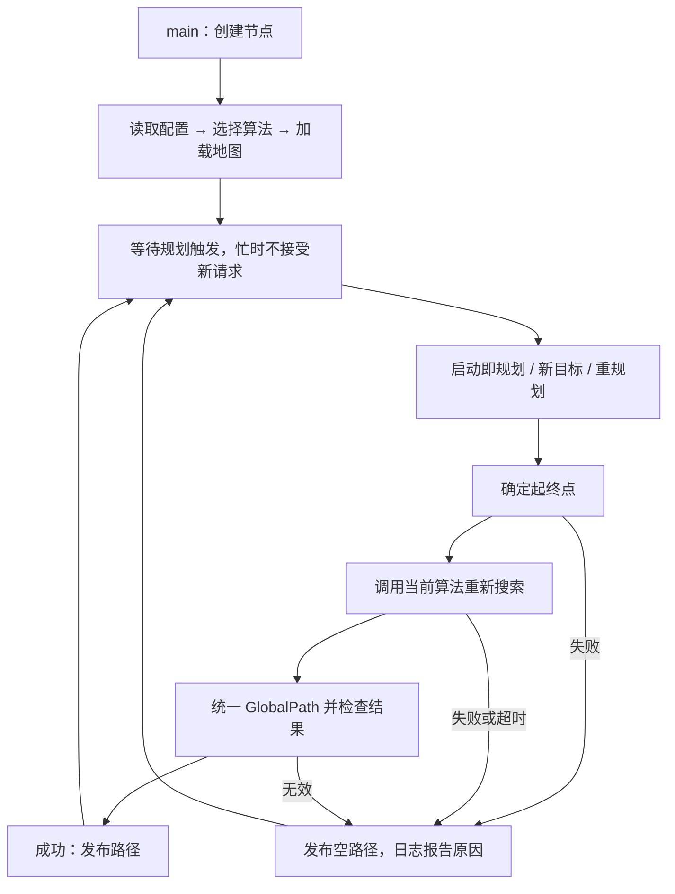
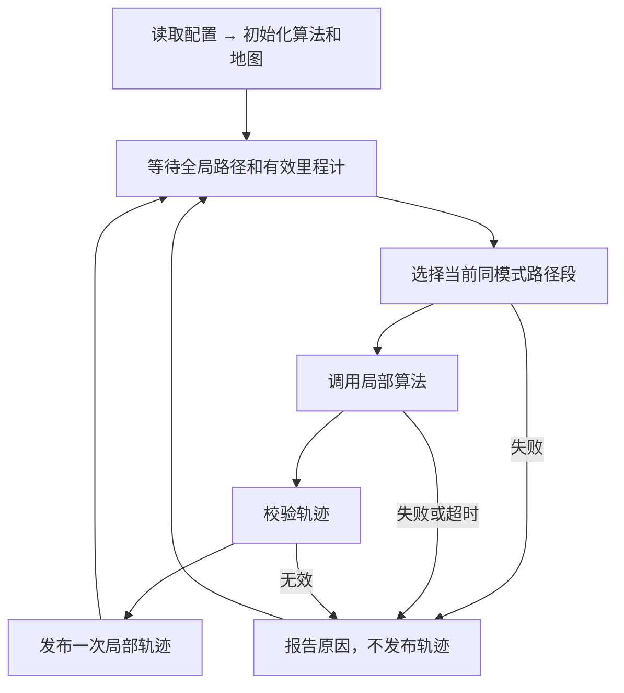
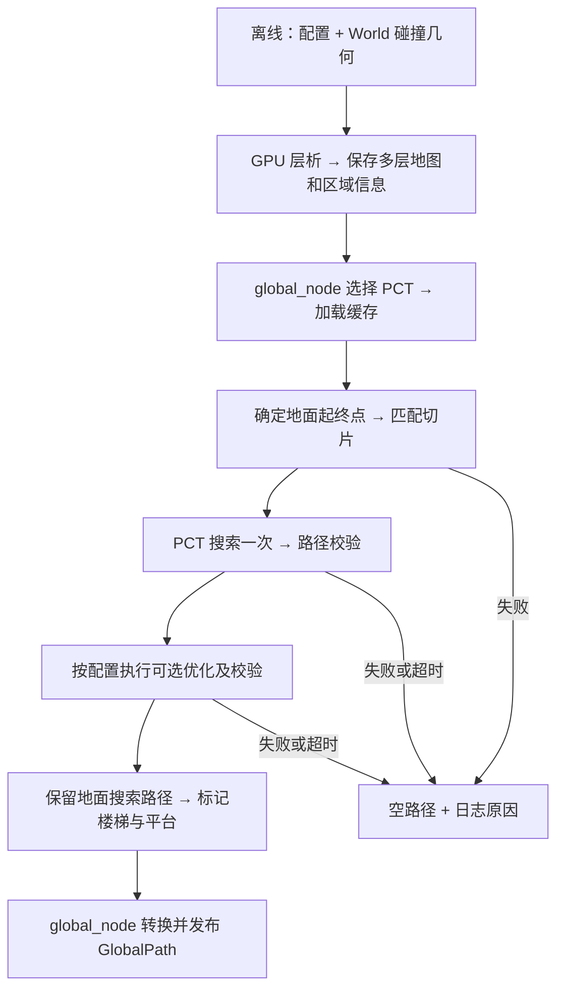
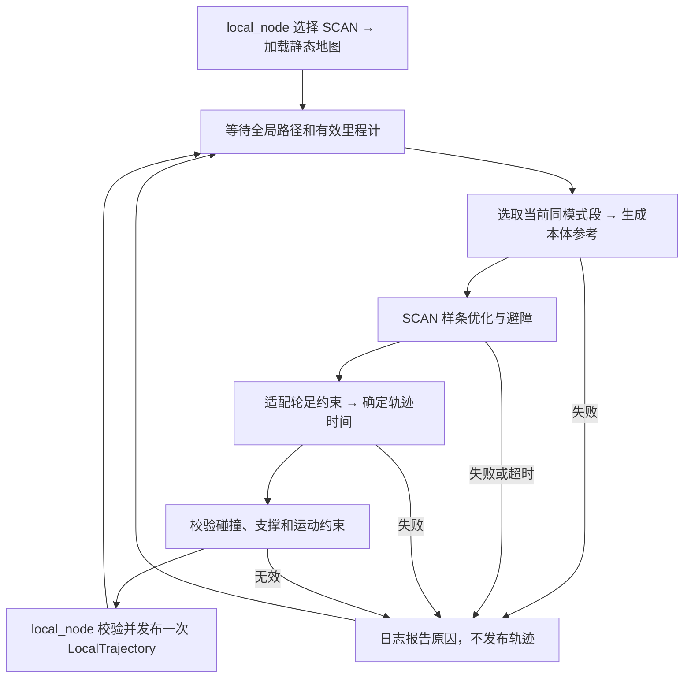

# D1：实现全局规划节点 `global_node.cpp`

目标：读取配置、选择算法、加载离线地图、确定起终点、规划并发布路径，支持新目标和重规划。

参数统一放在 `global_planning/config/global_cfg.yaml`：点位、起终点名称、起点来源（预设/里程计）、算法、地图路径、机器人通行约束、规划超时、是否启动即规划。地图预处理不在节点内执行。

允许修改或新增的文件（均相对项目根目录）：

| 文件 | 用途 |
| --- | --- |
| `src/global_planning/global_node.cpp` | 节点流程、回调、消息转换及必要检查 |
| `src/global_planning/config/global_cfg.yaml` | 点位与节点使用的参数 |
| `src/global_planning/global_node.h`（新增） | 各全局算法共用的请求、结果和调用接口，不实现算法 |
| `src/global_planning/CMakeLists.txt`（新增） | 编译节点、链接依赖、安装配置 |
| `src/global_planning/package.xml`（新增） | 声明 ROS 包及依赖 |

D1 不修改算法目录、局部规划、控制器、现有消息、仿真启动文件、README 和手册；不新增独立测试文件。算法尚未接入时，只验收构建启动、配置和通信流程、不可用算法的失败处理；成功路径验收随算法接入完成，不生成假路径代替。

代码结构（示意，不是实际实现）：

```cpp
// #include
// ROS 2、GlobalPath、Odometry、目标与重规划接口、YAML、算法统一接口

class GlobalNode : public rclcpp::Node {
  GlobalNode();          // 读取配置 → 初始化算法和地图 → 创建通信接口

  loadConfig();          // 读取 global_cfg.yaml，包括预设点位
  initPlanner();         // 选择 PCT / Mesh / GB，初始化对应算法
  loadMap();             // 加载该算法的离线地图缓存

  onOdom();              // 缓存最新里程计，供实际起点使用
  onGoal();              // 更新目标，触发规划
  onReplan();            // 保留目标，以最新实际位置重新规划

  resolveEndpoints();    // 起点按配置选择预设/里程计；目标从预设点位选择
  plan();                // 调用算法，传入地图、起终点、通行约束和超时
  buildGlobalPath();     // 转为 world 下的地面路径，整理 wheel/foot 模式
  validateResult();      // 检查非空、数值有效、首尾匹配、模式数量及取值
  publishResult();       // 成功发布路径；失败发布空路径并记录原因
};

int main();              // ROS 初始化 → 创建 GlobalNode → spin
```

执行流程：



- 输入：`/global_planning/goal`（`std_msgs/msg/String`，内容为预设目标名称）、`/global_node/replan`（`std_srvs/srv/Trigger`）、`/robot/odom`；输出：`/global_path`（现有 `interfaces/msg/GlobalPath`）。成功、失败及原因通过节点日志报告，不新增状态消息或话题。
- 新目标沿用配置指定的起点来源；重规划保留当前目标，使用最新实际位置。没有当前目标或有效里程计时，重规划请求失败；服务响应只表示是否受理，不表示规划成功。
- 必要检查：配置和点位有效、算法可用、地图文件可读；实际起点模式下里程计有效。初始化失败报告原因；不新增地图指纹或缓存校验机制，地图格式和专用检查随算法迁移实现。
- 地面起点结合地图支撑面确定，不直接使用里程计的本体 Z。模式划分依据楼梯、平台信息，中间平台保持 `foot`。
- 算法负责地图转换、搜索和专用通行校验；节点负责调度与结果统一。每次受理请求重新搜索，一次只处理一个请求；忙时拒绝新请求，不做任务取消、抢占和排队。
- 节点传入规划时限，拒绝发布超时结果；算法内部的中止能力随算法迁移实现，不承诺节点能强制终止算法。
- 节点不生成局部轨迹，不控制机器人；失败清空路径不等于停车。

验收：节点可构建启动，配置、点位选择、目标与重规划入口可检查；未接入算法明确报错，规划失败发布空路径并记录原因。真实地图加载、成功路径和算法超时处理随算法接入验收。仅做必要验证，清理本次临时产物。

# D2：实现局部规划节点 `local_node.cpp`

目标：接收全局路径和机器人实际状态，调用局部算法生成、校验并发布当前段轨迹。本阶段不负责连续执行调度。

节点参数放在 `local_planning/config/local_cfg.yaml`：算法、地图路径、局部规划范围和规划超时。执行约束读取现有 `control/config/control.yaml`，不重复配置。

允许修改或新增的文件（均相对项目根目录）：

| 文件 | 用途 |
| --- | --- |
| `src/local_planning/local_node.cpp` | 路径接收、算法调用、轨迹校验和发布 |
| `src/local_planning/config/local_cfg.yaml`（新增） | 局部节点参数 |
| `src/local_planning/local_node.h`（新增） | 局部算法共用的请求、结果和调用接口 |
| `src/local_planning/CMakeLists.txt`、`package.xml`（新增） | 编译、安装和依赖声明 |

D2 不迁移算法，不修改控制器、现有消息、D1、机器人模型、场景、README 和手册，不新增独立测试文件。

代码结构（示意，不是实际实现）：

```cpp
// #include
// ROS 2、GlobalPath、LocalTrajectory、Odometry、YAML、算法调用接口

class LocalNode : public rclcpp::Node {
  LocalNode();           // 读取配置 → 初始化算法和地图 → 创建通信接口

  loadConfig();          // 读取 local_cfg.yaml 和现有执行约束
  initPlanner();         // 选择 TEB / EGO / SCAN / MPPI
  loadMap();             // 加载算法需要的地图

  onGlobalPath();        // 缓存最新路径，路径和里程计齐备后触发一次规划
  onOdom();              // 缓存实际位姿和速度；仅唤起尚未处理的路径，不连续发布
  selectSegment();       // 根据实际位置选取当前同模式路径段及局部目标
  plan();                // 输入实际状态、路径段、地图、障碍和约束，输出带时间本体轨迹
  validateTrajectory();  // 检查模式、位姿、时间、首点衔接和运动约束
  publishTrajectory();   // 转为现有 LocalTrajectory，成功时发布一次
};

int main();              // ROS 初始化 → 创建 LocalNode → spin
```

执行流程：



- 输入：`/global_path`（`interfaces/msg/GlobalPath`）、`/robot/odom`；输出：`/local_trajectory`（现有 `interfaces/msg/LocalTrajectory`）。失败原因通过节点日志报告。
- 每次收到非空路径最多规划、发布一次；里程计更新不重复规划。收到空路径清除待处理路径。初始化失败或算法不可用时报告原因，不生成替代轨迹。
- `/global_path` 使用 reliable、transient_local、深度 1；`/local_trajectory` 使用 reliable、volatile、深度 1，不重放旧执行轨迹。
- 全局路径使用地面高度，局部轨迹使用 `world` 下的 `base_link` 位姿；每条轨迹只包含一种模式，首点时间为零，后续严格递增。
- 模式切换仍由现有控制器完成，轨迹首点对应切换完成后的位姿；单阶动作不拆开，中间平台保持 `foot`。
- 必要检查：路径和里程计有效、算法支持当前模式、轨迹满足现有控制器约束。收到空路径不生成轨迹，不发送空轨迹充当停车命令。
- 算法专用地图、碰撞及通行校验随算法迁移接入；本阶段不新增动态障碍来源，不宣称具备动态避障能力。规划时限处理与 D1 一致。
- 本阶段仅在控制器空闲时验证单段下发；不判断控制器是否接受或完成，不自动推进下一段、不自动重规划，也不在执行中测试新路径替换。

验收：节点可构建启动；未接入算法明确报错。算法接入后验证单段轨迹格式及发布，不把发布成功当作执行成功。仅做必要验证，清理本次临时产物。

# D3：迁移 PCT，接通真实全局路径

目标：复用参考项目的 PCT 地图处理、搜索、优化及已有修复，通过 D1 发布真实地面路径和轮足模式。

参数统一放在 `global_planning/config/global_cfg.yaml`：World 和缓存路径、地图生成参数、PCT 搜索与优化参数。先核实当前机器人的包络、通行能力及依赖，不照搬旧机器人的数值。

允许修改或新增的文件（均相对项目根目录）：

| 文件 | 用途 |
| --- | --- |
| `src/global_planning/pct/` | PCT 适配器、离线地图脚本、第三方核心、必要构建配置和许可证 |
| `src/global_planning/global_node.cpp` | 在算法选择处创建 PCT 适配器，保持通用流程 |
| `src/global_planning/config/global_cfg.yaml` | PCT 参数及已确认的机器人约束 |
| `src/global_planning/CMakeLists.txt`、`package.xml` | 编译、链接和安装 PCT 所需资源 |
| `docker/Dockerfile` | 仅在现有镜像缺少必要依赖时补充 |

D3 不修改局部节点、控制器、现有消息、World、URDF、README 和手册；不搬旧导航节点、同层执行适配器及预定义楼梯路线替换逻辑。

代码结构（示意，不是实际实现）：

```cpp
// #include
// global_node.h、PCT 搜索与优化核心、PCT 地图读取

class PctPlanner : public GlobalPlanner {
  loadMap();             // 读取 PCTMAP02 缓存及配套楼梯、平台区域信息
  groundPose();          // 结合地图支撑面与轮足站高，将本体位姿匹配到地面
  plan();                // 高度切片匹配 → 搜索一次 → 校验 → 可选优化
  classifyTerrain();     // 根据区域信息生成逐边 Flat / Stair / StairLanding
};

// 离线 Python：prepare_map.py → tomogram.py、kernels.py
// 读取配置与 World 碰撞几何，生成地图缓存及配套区域信息。
```

执行流程：



- 保留参考项目的坐标转换、未知区域禁行、边检查、单次搜索后优化及插值修复，不替换搜索算法，不用其他算法兜底。
- 地图预处理只离线执行，节点不启动生成脚本；保留原脚本已有缓存复用机制。日常只生成运行必需的缓存和元数据，不默认导出点云、绘图及重复数组文件。
- 从当前 World 提取楼梯及中间平台区域，离线保存用于地形标记；原 PCT 缓存不含这些语义，不能只看路径高度变化。保留原始搜索路线，不替换为旧执行器的楼梯参考路线。
- `/global_path` 始终输出地面搜索路径。优化代码同时迁入，默认关闭；启用时优化机身参考仅在 PCT 内保留，不冒充地面路径、不新增话题，优化失败则整个请求失败。
- 实际起点必须匹配有效支撑面；无法确定或存在歧义时失败，不直接使用本体 Z，也不盲目减去固定站高。
- 搜索沿用已有合作式超时检查；优化保留迭代上限，超时结果不发布，不承诺强制中断优化。

验收：

- 容器可构建；当前 World 可离线生成缓存、重复运行可复用缓存，节点能加载。
- 路线验证：`F1-ENTRY → F1-ROOM`、`F1-STAIR → F2-STAIR`、`F1-ENTRY → F3-EAST`，以及这三条路线的反向。
- 成功路径首尾、坐标和地面高度正确，通过 PCT 支撑、代价、净空、膨胀包络和台阶高度校验；模式数量正确，楼梯及中间平台保持 `foot`。
- 错误高度、损坏地图、不可达和超时请求明确失败并清空路径；启用优化的代表路线通过优化校验，不重复搜索。
- 若当前机器人约束导致约定路线不可达，报告证据再讨论，不擅自放宽阈值或调整点位。不承诺全部点对可达，不验收局部轨迹及机器人执行。
- 只做必要验证，清理临时产物；正式地图缓存及其必要元数据作为运行资源保留。

# D4：迁移上游 SCAN，接通真实局部轨迹

目标：基于 `/home/hfun/norin/SCAN-Planner`（上游 `main`，版本 `348e8a5`），通过 D2 为当前同模式路径段生成可执行的本体轨迹，支持 `wheel / foot`。本阶段不实现连续执行调度。

参数放在 `local_planning/config/local_cfg.yaml`：选择 `scan`、World 路径、地图分辨率、机器人碰撞包络、样条与优化参数、采样间隔。速度、站高、足步预算及容差读取现有 `control/config/control.yaml`，不重复配置。

允许修改或新增的文件（均相对项目根目录）：

| 文件 | 用途 |
| --- | --- |
| `src/local_planning/scan/` | SCAN 数值核心、适配器、地图查询、必要构建配置和许可证 |
| `src/local_planning/local_node.cpp` | 创建 SCAN 适配器、传入配置，保持 D2 通用流程 |
| `src/local_planning/config/local_cfg.yaml` | SCAN 参数及当前场景路径 |
| `src/local_planning/CMakeLists.txt`、`package.xml` | 编译、链接和安装所需资源 |

D4 不修改 PCT、全局节点、控制器、现有消息、World、URDF、README 和手册；不搬上游 ROS 节点、仿真器、传感器系统和控制器，不新增动态障碍来源或独立测试文件。

代码结构（示意，不是实际实现）：

```cpp
// #include
// local_node.h、SCAN 样条与优化核心、静态地图查询

class ScanPlanner : public LocalPlanner {
  loadMap();             // 读取 three_floor.world 碰撞几何，建立碰撞与支撑查询
  supports();            // 支持 wheel / foot
  plan();                // 接收 LocalRequest，生成当前段的 LocalResult
  buildBodyReference();  // 地面路径 → 按模式站高生成本体高度参考
  optimize();            // 调用 SCAN 样条优化及 A* 避障引导
  buildTrajectory();     // 适配轮足运动约束，生成 XYZ、yaw 和时间
  validateResult();      // 检查碰撞、支撑、运动约束及超时
};
```

执行流程：



- 输入沿用 `LocalRequest`：实际 odom、当前同模式地面路径、执行约束和截止时间；输出沿用 `LocalResult / LocalTrajectory`，不新增接口或话题。
- 地图在启动时读取当前 World 的静态碰撞几何，在 SCAN 内适配空间占据、机器人包络碰撞和地面支撑查询；不把 PCT 代价图直接当作完整三维碰撞地图。
- 保留上游 B 样条、优化器、A* 避障引导和空间碰撞检查。机器人包络使用当前模型尺寸，不照搬 Go2 的双圆柱参数；不引入其他算法兜底。
- `wheel` 固定支撑高度，禁止横移，满足现有控制器的轮式运动约束；`foot` 保留楼梯高度变化和中间平台，按足式站高生成本体参考。
- 上游优化器固定 Z，沿用这一边界；将起终点线性插值的高度参考改为沿途地形参考，不把楼梯与平台拉成一条斜坡。XY 优化后重新检查支撑和净空，不允许跨越无支撑区域。
- 本体姿态仅包含 yaw，roll/pitch 保持为零。轨迹首点衔接实际 XY、yaw 和目标模式站高；时间从零严格递增，满足速度、转向和足步预算。足端动作及轮足切换仍由现有控制器负责。
- 保持 D2 每条全局路径最多规划、发布一次；不自动推进下一段、不自动重规划、不修改执行反馈或轨迹替换规则。超时或无效结果不发布，不用空轨迹充当停车命令。

验收：

- 容器可构建，SCAN 可初始化并加载当前 World；真实输入能生成现有消息格式的轨迹。
- 同层轮式验证 `F1-ENTRY → F1-ROOM` 的当前局部段；足式验证 `F1-STAIR → F2-STAIR` 及反向的当前同模式段，覆盖上下楼和中间平台转弯。
- 轨迹通过碰撞、支撑和运动约束检查；控制器空闲时验证单段实际执行，无碰撞、足端不可达或关节保护冻结，不把规划、发布或接受成功当作执行成功。
- 无支撑、碰撞、不可行或超时请求明确失败，不发布轨迹。若当前机器人或固定 Z 方案无法完成约定路线，报告证据再讨论，不放宽约束、不修改点位或控制器。
- 不验收完整跨层任务的自动连续执行；仅做必要验证，清理本次临时产物。

# D4.1：统一 SCAN 与控制器的足步约束

目标：修复上下楼落脚净空不足、髋关节分支跳变，使现有全局 → SCAN → 轮足控制链路可执行。

本节仅放开 D4 中控制器足步相关修改，其他边界不变。

| 允许修改的文件 | 用途 |
| --- | --- |
| `src/control/include/control.h`、`src/control/src/control.cpp` | 落脚候选及摆动过程检查、连续 IK 选择；保留自动交替步态和异常保护 |
| `src/control/config/control.yaml` | 必要的足步净空参数，SCAN 读取同一值，不重复配置 |
| `src/local_planning/scan/scan_map.h`、`scan_map.cpp` | 同步控制器足步规则，检查实际支撑脚、摆动脚及关节连续性 |
| `src/local_planning/scan/scan_planner.h`、`scan_planner.cpp` | 根据足步可达性调整本体 XYZ、yaw 和时间，保留 SCAN 数值核心 |
| `src/local_planning/local_node.cpp`、`config/local_cfg.yaml` | 传递必要参数，不改变 D2 调度与接口 |

```cpp
// 控制器：候选落点 → 完整支撑 → 净空/摆动可行 → 连续 IK → 自动交替执行
// SCAN：地形参考 → 本体轨迹 → 按同一足步规则回放 → 有效才发布
// 必要方法放回现有类，不新增节点、消息或独立规划算法。
```

- 非支撑障碍净空保持 0.05 m，URDF 位置和速度限制保持不变；不以放宽保护通过验收。
- 控制器与 SCAN 使用一致的候选顺序、支撑/摆动判定和 IK 分支规则；无可行候选明确失败。
- 本体轨迹同时考虑保留支撑脚、交替摆动及平台转向，不能只对最终轨迹减速。
- 不改 PCT、全局节点、现有消息、World、URDF、执行反馈及轨迹替换规则，不引入额外足式算法。

验收顺序：构建 → 单级上下（净空、关节连续性）→ 真实 PCT 上下楼当前足式段及平台转弯 → 控制器实际执行；回归同层轮式及不可行请求。规划成功不代表执行验收通过，失败保留原因，临时产物清理。

# D4.2：统一理想机器人，打通一楼到三楼

目标：默认使用理想方块模型测评局部规划算法，不再维护旧轮足模式；自动完成 `F1-ENTRY → F3-EAST`。

本节替代 D2 的单次局部段调度及 D4/D4.1 的真实轮足执行要求。旧 `control.h/control.cpp` 原样保留，不编译、不加载；其他旧模型、专属参数和适配分支删除。后续公司机器人接入另行设计。

| 允许修改、新增或删除的文件 | 用途 |
| --- | --- |
| `src/control/src/ideal_control.cpp`（新增） | 理想 Gazebo 执行器，插值执行 XYZ/yaw，发布 odom |
| `src/control/urdf/ideal_robot.urdf`、`config/ideal.yaml`（新增） | 方块外观、单一参考高度、反馈周期及衔接容差；替代旧模型和控制配置 |
| `src/control/urdf/robot.urdf`、`config/control.yaml` | 删除旧模型和专属行为参数 |
| `src/control/CMakeLists.txt`、`package.xml` | 只构建新执行器，清理旧依赖；旧轮足专用测试随依赖清理，不新增常驻测试文件 |
| `src/sim_bringup/launch/sim.launch.py` | 默认加载理想模型与新配置，删除旧模型、旧控制参数及模式切换入口 |
| `src/local_planning/local_node.h`、`local_node.cpp`、`config/local_cfg.yaml` | 清理旧轮足约束，配置通用测评参数，按 odom 自动推进局部段 |
| `src/local_planning/scan/scan_planner.h`、`scan_planner.cpp`、`scan_map.h`、`scan_map.cpp` | 删除旧机器人适配，使用点轨迹避障及通用运动约束，保留 SCAN 数值核心 |
| `src/global_planning/config/global_cfg.yaml`、`pct/pct_planner.cpp` | 移除旧 control.yaml 和双站高依赖，改用理想模型参考高度；全局算法核心不改 |

```cpp
// IdealTrajectoryControl : gazebo::ModelPlugin
// Load()               // 加载理想配置、轨迹订阅、仿真更新及 odom 发布
// ReceiveTrajectory()  // 检查格式、时间与起点衔接；忙时拒绝新轨迹
// Update()             // 按仿真时间插值 XYZ/yaw，直接设置模型位姿
// PublishOdometry()    // 发布 world/base_link 位姿与速度
// local_node：全局路径 → 当前局部段 → 规划发布 → odom 确认执行完成 → 下一段
```

执行规则：

- 输入沿用 `/local_trajectory`，输出沿用 `/robot/odom`，不新增消息或反馈协议。方块仅用于显示，规划视为点，不考虑方块尺寸、腿脚或关节。
- 关闭模型重力和物理碰撞响应，仅由新执行器控制位姿；不再计算 IK、轮足切换或发布虚构关节动作。
- world 下 XYZ 线性插值、yaw 最短角插值，roll/pitch 为零；按仿真时间计时，暂停时不推进，结束后保持末位姿并发布零速度。
- 消息必须数值有限、首点时间为零、其后严格递增；首点衔接实际 XYZ/yaw，不允许瞬移。无效输入拒绝，执行中不替换轨迹。
- 单一参考高度放 `ideal.yaml`，全局适配器、局部节点和启动位置共同使用；测评线速度、角速度、加速度及点障碍间距放 `local_cfg.yaml`，不保留 wheel/foot 两套参数。

规划与连续执行：

- 删除机器人包络、足底支撑、IK、关节限位、步态回放、足式高度投影、足步预算及轮式禁止侧移等旧约束，不保留旧模式分支。
- 保留 SCAN 样条优化、A* 引导、地形高度及平台参考、通用速度/加速度限制、格式/端点/超时检查。检查完整插值轨迹与 World 的点障碍间距，不允许穿墙或穿楼板。
- 全局消息中的 wheel/foot 可保留为地形标签，不触发不同控制行为；局部段按规划范围和地形连续性截取，阶梯及平台高度不得丢失。
- 每次只发布一个局部段。经过该段执行时长，且收到新鲜 odom 确认到达段末并静止后，再推进下一段，直至全局终点；不重复发布已完成段。
- 规划失败、超时或执行未完成时停止推进并报告原因，不以瞬移、跳段或无限重试完成任务。不增加任务框架、动态障碍系统或独立足式算法。
- PCT 搜索核心、全局节点通用逻辑、现有消息及 World 保持不变；不修改 README 和手册。

验收：

- 构建通过，默认启动理想方块，只有一个位姿控制源和 odom 发布源，不再依赖旧模型、旧参数或旧控制插件。
- 使用真实 PCT 路径，从 `F1-ENTRY` 自动执行到 `F3-EAST`，覆盖两层楼梯及平台转弯；无需手动逐段触发，无穿障碍、停滞、跳段或重复执行。
- 实际位姿相对当前轨迹的跟随误差及最终位置误差不超过 0.01 m，yaw 误差不超过 0.01 rad；结束后保持静止。
- 记录本次各局部段规划耗时、成功/失败、路径长度、速度/加速度及最小点障碍间距；跟随误差单列，不作为算法优劣指标。不新增报告系统。
- 必要验证覆盖非法输入、忙时拒绝及暂停/恢复，临时脚本与记录用后清理。结果只证明理想点模型下的规划与执行效果。

# D5：真实任务数据 HMI 可视化

目标：在一个网页内展示实际离线地图、规划结果、实时话题和机器人运动，并操作 `F1-ENTRY → F3-EAST` 完整任务；不使用假路径或预制动画。

技术：React + Three.js；Python FastAPI + rclpy 后端，通过 WebSocket 推送话题，通过 HTTP 接收操作。后端运行在 ROS 环境中，复用 ROS 2 launch；不另引入 rosbridge、数据库或 Gazebo 视频推流。

页面布局与真实数据：

| 区域 | 内容及来源 |
| --- | --- |
| 顶部地图输入区 | 当前 PCT 缓存的真实地面/高度切片预览、文件名、分辨率与范围；可选择楼层，不拿 World 外观冒充离线规划地图 |
| 顶部全局输出区 | `/global_path` 的点数、XYZ、四元数、逐边模式、消息时间；支持展开查看完整消息 |
| 顶部局部输出区 | `/local_trajectory` 的模式、点数、XYZ/yaw、相对时间和完整消息；每次真实发布新段才更新 |
| 实时状态区 | `/robot/odom` 的仿真时间、XYZ、yaw、线速度和角速度；显示数据是否连接、最近接收时间 |
| 下方地图总览 | 从当前 World 碰撞几何构建三维场景，蓝色全局路径、橙色当前局部轨迹、灰色已走轨迹及理想方块 |
| 下方跟随视角 | 同一 Three.js 场景的跟随相机，由实际 odom 驱动；不是嵌入 Gazebo 窗口 |
| 右侧控制面板 | 仿真启停、暂停恢复、起终点、算法、全局规划、任务启动及成功/失败原因 |

- 三维视图统一采用 world 米制坐标；全局路径以地面高度原样绘制，局部轨迹按本体高度原样绘制，不为重叠显示篡改数据。
- 话题区展示实际消息，提供滚动和暂停显示；暂停显示不暂停仿真。全局结果按任务更新、局部结果按段更新、odom 连续更新，不伪造实时刷新。
- 全量地图首次加载后复用；全局/局部轨迹按消息事件更新，odom 网页推送限频至 20 Hz，不影响 ROS 规划和控制频率。

控制顺序：

1. **启动仿真**：加载当前场景和理想模型，启动所需节点，等待有效 odom；HMI 启动的局部节点关闭自动执行。
2. **选择起终点、算法**：点位读取 `global_cfg.yaml` 的九个预设；目前仅 PCT、SCAN 可选，未接入算法禁用。空闲时设置起点，将理想模型放置到对应地面高度加参考高度；执行中锁定选择。
3. **开始全局规划**：按当前选择调用全局节点，显示实际 `/global_path`；机器人保持静止。离线的是地图预处理，不是本次路径搜索。
4. **启动任务**：仅本次配置对应的全局规划成功、路径非空且 odom 有效时可用；局部节点执行“规划当前段 → 控制 → odom 确认 → 下一段”，直至终点。
5. **暂停/恢复仿真**：停止/继续仿真时间，保留当前任务，不重发已执行轨迹。
6. **停止仿真**：停止本次 HMI 管理的进程，清空当前任务和旧数据有效标记；不终止外部启动的仿真。起终点或算法改变后旧路径失效，必须重新全局规划。

职责与接口：

- `sim_bringup` 管模型、场景和节点启动参数；HMI 后端管本次进程生命周期、地图转换、话题转发和固定操作接口；前端只展示和提交操作。
- HMI 后端提供 `/api/simulation/start|stop|pause|resume`、`/api/planning/global`、`/api/task/start`；配置/地图读取使用只读接口，WebSocket `/ws` 推送实际消息及状态。前端不发送任意 shell 命令。
- 局部节点增加 `auto_execute` 参数（独立运行默认 true，HMI 启动设 false）及 `/local_node/start_task`（`std_srvs/srv/Trigger`）；关闭自动执行时收到全局路径只缓存，服务启动后才规划发布。忙时拒绝新任务，不新增抢占、取消或队列。
- 全局/局部节点分别发布 `/global_planning/status`、`/local_planning/status`（`std_msgs/msg/String`，JSON 字段 `state`、`reason`，局部另含当前/总路径索引）。状态至少覆盖空闲、规划中、就绪、执行中、完成、失败，以节点真实事件更新，保留最新状态供重连读取；不靠解析日志判断成功。
- 全局成功必须同时取得本次有效路径；服务受理不等于规划或任务完成。断连、空路径、规划失败时禁用任务启动；任务完成以局部节点确认最终 odom 到位且静止为准。
- 浏览器刷新/重连只恢复展示，不重复启动仿真或任务；暂停或未启动时不把 odom 停更直接当作执行失败。后端不在线时明确显示断连，不继续模拟运动。

允许修改或新增的文件（相对项目根目录）：

| 文件 | 用途 |
| --- | --- |
| `src/hmi/` | 前端、ROS 桥接后端、必要依赖与启动配置；只建实际使用的文件 |
| `src/sim_bringup/launch/`、必要 `CMakeLists.txt/package.xml` | 统一启动规划节点、传入 HMI 的自动执行开关和本次配置 |
| `src/global_planning/global_node.cpp` | 增加真实规划状态发布，保留搜索与原消息接口 |
| `src/local_planning/local_node.cpp` | 缓存路径、显式启动任务、真实执行状态发布；保留 D4.2 连续推进 |
| 上述包的 `CMakeLists.txt/package.xml` | 必要接口依赖和安装配置 |
| `docker/Dockerfile`、`docker/compose.yaml` | 仅补充运行 HMI 必需的依赖或网络配置 |

不改 PCT/SCAN 核心、`GlobalPath/LocalTrajectory` 消息、理想执行器、World、模型、预设点位及算法参数；不修改 README/手册。HMI 选择通过节点启动参数和本次临时配置传递，不覆盖项目原始配置。未接入算法不新增适配；不增加历史任务、账号、数据库、动态障碍或报表系统。

实现顺序：真实地图和话题接入 → 双视角及实际路径绘制 → 任务启动开关和状态 → 控制面板 → 完整任务验收。

验收：网页启动仿真，选择 `F1-ENTRY → F3-EAST`，先全局规划且机器人不动，再手动点击一次启动任务，自动执行至终点并显示完成。页面地图来自实际缓存/World，话题内容与 ROS 一致，局部线逐段更新，双视角运动来自 odom；确认暂停恢复、断连显示及刷新不重复任务。仅做必要验证并清理临时配置、脚本和记录，不新增常驻测试文件。
