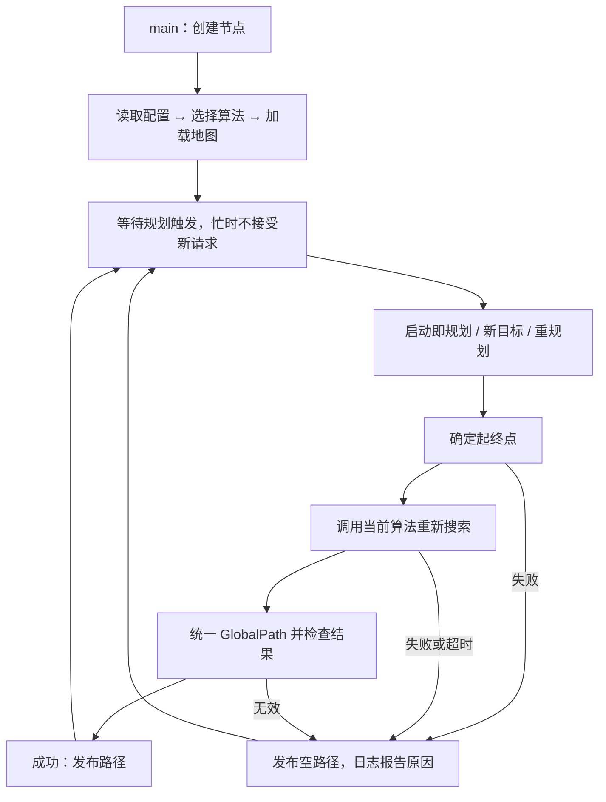
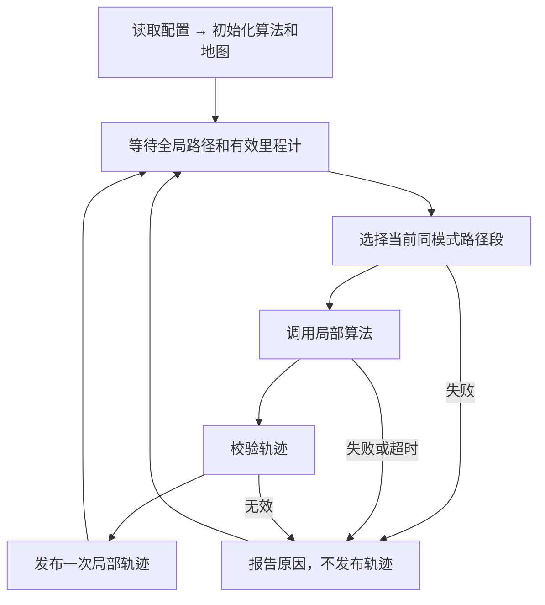
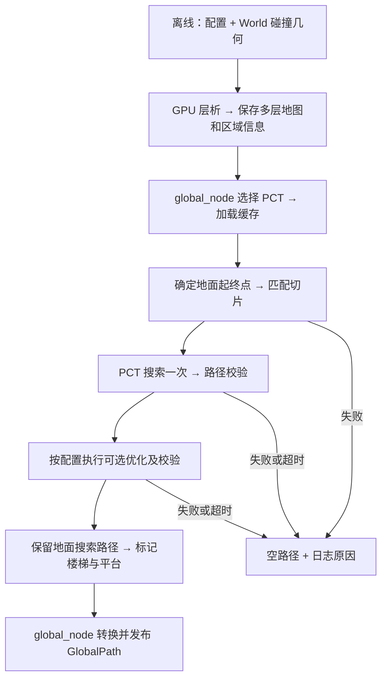
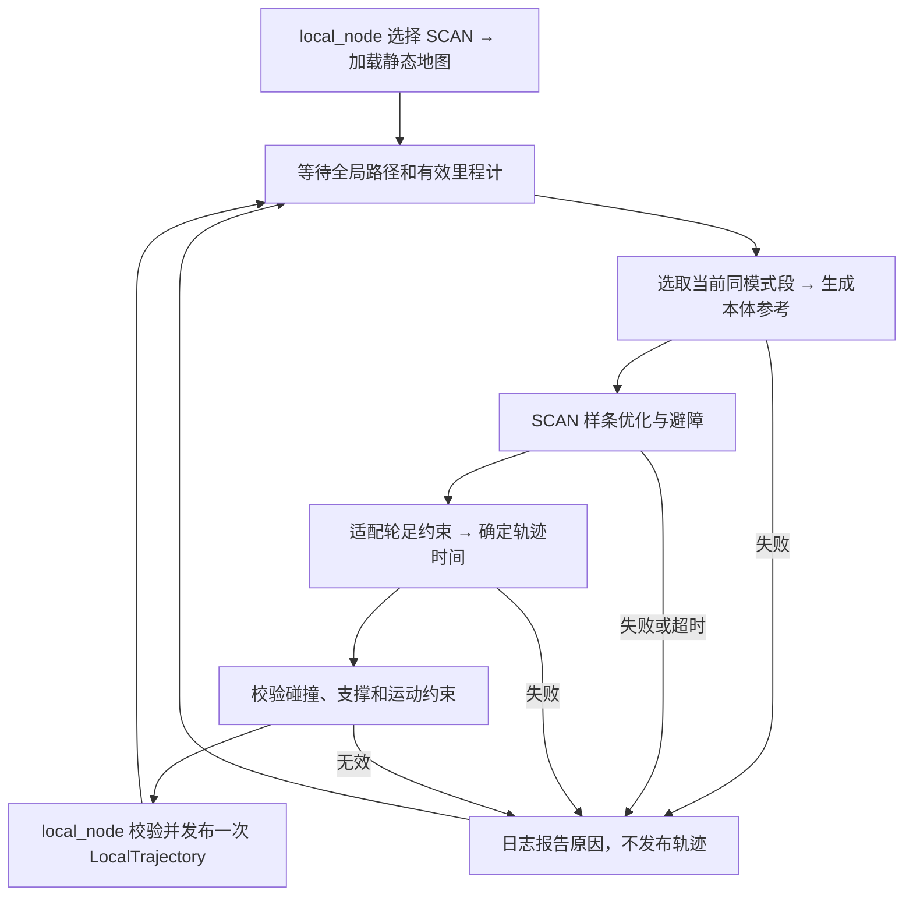

# D1：实现全局规划节点 `global_node.cpp`

目标：读取配置、选择算法、加载离线地图、确定起终点、规划并发布路径，支持新目标和重规划。

参数统一放在 `global_planning/config/global_cfg.yaml`：点位、起终点名称、起点来源（预设/里程计）、算法、地图路径、机器人通行约束、规划超时、是否启动即规划。地图预处理不在节点内执行。

允许修改或新增的文件（均相对项目根目录）：

| 文件 | 用途 |
| --- | --- |
| `src/global_planning/global_node.cpp` | 节点流程、回调、消息转换及必要检查 |
| `src/global_planning/config/global_cfg.yaml` | 点位与节点使用的参数 |
| `src/global_planning/global_node.h`（新增） | 各全局算法共用的请求、结果和调用接口，不实现算法 |
| `src/global_planning/CMakeLists.txt`（新增） | 编译节点、链接依赖、安装配置 |
| `src/global_planning/package.xml`（新增） | 声明 ROS 包及依赖 |

D1 不修改算法目录、局部规划、控制器、现有消息、仿真启动文件、README 和手册；不新增独立测试文件。算法尚未接入时，只验收构建启动、配置和通信流程、不可用算法的失败处理；成功路径验收随算法接入完成，不生成假路径代替。

代码结构（示意，不是实际实现）：

```cpp
// #include
// ROS 2、GlobalPath、Odometry、目标与重规划接口、YAML、算法统一接口

class GlobalNode : public rclcpp::Node {
  GlobalNode();          // 读取配置 → 初始化算法和地图 → 创建通信接口

  loadConfig();          // 读取 global_cfg.yaml，包括预设点位
  initPlanner();         // 选择 PCT / Mesh / GB，初始化对应算法
  loadMap();             // 加载该算法的离线地图缓存

  onOdom();              // 缓存最新里程计，供实际起点使用
  onGoal();              // 更新目标，触发规划
  onReplan();            // 保留目标，以最新实际位置重新规划

  resolveEndpoints();    // 起点按配置选择预设/里程计；目标从预设点位选择
  plan();                // 调用算法，传入地图、起终点、通行约束和超时
  buildGlobalPath();     // 转为 world 下的地面路径，整理 wheel/foot 模式
  validateResult();      // 检查非空、数值有效、首尾匹配、模式数量及取值
  publishResult();       // 成功发布路径；失败发布空路径并记录原因
};

int main();              // ROS 初始化 → 创建 GlobalNode → spin
```

执行流程：



- 输入：`/global_planning/goal`（`std_msgs/msg/String`，内容为预设目标名称）、`/global_node/replan`（`std_srvs/srv/Trigger`）、`/robot/odom`；输出：`/global_path`（现有 `interfaces/msg/GlobalPath`）。成功、失败及原因通过节点日志报告，不新增状态消息或话题。
- 新目标沿用配置指定的起点来源；重规划保留当前目标，使用最新实际位置。没有当前目标或有效里程计时，重规划请求失败；服务响应只表示是否受理，不表示规划成功。
- 必要检查：配置和点位有效、算法可用、地图文件可读；实际起点模式下里程计有效。初始化失败报告原因；不新增地图指纹或缓存校验机制，地图格式和专用检查随算法迁移实现。
- 地面起点结合地图支撑面确定，不直接使用里程计的本体 Z。模式划分依据楼梯、平台信息，中间平台保持 `foot`。
- 算法负责地图转换、搜索和专用通行校验；节点负责调度与结果统一。每次受理请求重新搜索，一次只处理一个请求；忙时拒绝新请求，不做任务取消、抢占和排队。
- 节点传入规划时限，拒绝发布超时结果；算法内部的中止能力随算法迁移实现，不承诺节点能强制终止算法。
- 节点不生成局部轨迹，不控制机器人；失败清空路径不等于停车。

验收：节点可构建启动，配置、点位选择、目标与重规划入口可检查；未接入算法明确报错，规划失败发布空路径并记录原因。真实地图加载、成功路径和算法超时处理随算法接入验收。仅做必要验证，清理本次临时产物。

# D2：实现局部规划节点 `local_node.cpp`

目标：接收全局路径和机器人实际状态，调用局部算法生成、校验并发布当前段轨迹。本阶段不负责连续执行调度。

节点参数放在 `local_planning/config/local_cfg.yaml`：算法、地图路径、局部规划范围和规划超时。执行约束读取现有 `control/config/control.yaml`，不重复配置。

允许修改或新增的文件（均相对项目根目录）：

| 文件 | 用途 |
| --- | --- |
| `src/local_planning/local_node.cpp` | 路径接收、算法调用、轨迹校验和发布 |
| `src/local_planning/config/local_cfg.yaml`（新增） | 局部节点参数 |
| `src/local_planning/local_node.h`（新增） | 局部算法共用的请求、结果和调用接口 |
| `src/local_planning/CMakeLists.txt`、`package.xml`（新增） | 编译、安装和依赖声明 |

D2 不迁移算法，不修改控制器、现有消息、D1、机器人模型、场景、README 和手册，不新增独立测试文件。

代码结构（示意，不是实际实现）：

```cpp
// #include
// ROS 2、GlobalPath、LocalTrajectory、Odometry、YAML、算法调用接口

class LocalNode : public rclcpp::Node {
  LocalNode();           // 读取配置 → 初始化算法和地图 → 创建通信接口

  loadConfig();          // 读取 local_cfg.yaml 和现有执行约束
  initPlanner();         // 选择 TEB / EGO / SCAN / MPPI
  loadMap();             // 加载算法需要的地图

  onGlobalPath();        // 缓存最新路径，路径和里程计齐备后触发一次规划
  onOdom();              // 缓存实际位姿和速度；仅唤起尚未处理的路径，不连续发布
  selectSegment();       // 根据实际位置选取当前同模式路径段及局部目标
  plan();                // 输入实际状态、路径段、地图、障碍和约束，输出带时间本体轨迹
  validateTrajectory();  // 检查模式、位姿、时间、首点衔接和运动约束
  publishTrajectory();   // 转为现有 LocalTrajectory，成功时发布一次
};

int main();              // ROS 初始化 → 创建 LocalNode → spin
```

执行流程：



- 输入：`/global_path`（`interfaces/msg/GlobalPath`）、`/robot/odom`；输出：`/local_trajectory`（现有 `interfaces/msg/LocalTrajectory`）。失败原因通过节点日志报告。
- 每次收到非空路径最多规划、发布一次；里程计更新不重复规划。收到空路径清除待处理路径。初始化失败或算法不可用时报告原因，不生成替代轨迹。
- `/global_path` 使用 reliable、transient_local、深度 1；`/local_trajectory` 使用 reliable、volatile、深度 1，不重放旧执行轨迹。
- 全局路径使用地面高度，局部轨迹使用 `world` 下的 `base_link` 位姿；每条轨迹只包含一种模式，首点时间为零，后续严格递增。
- 模式切换仍由现有控制器完成，轨迹首点对应切换完成后的位姿；单阶动作不拆开，中间平台保持 `foot`。
- 必要检查：路径和里程计有效、算法支持当前模式、轨迹满足现有控制器约束。收到空路径不生成轨迹，不发送空轨迹充当停车命令。
- 算法专用地图、碰撞及通行校验随算法迁移接入；本阶段不新增动态障碍来源，不宣称具备动态避障能力。规划时限处理与 D1 一致。
- 本阶段仅在控制器空闲时验证单段下发；不判断控制器是否接受或完成，不自动推进下一段、不自动重规划，也不在执行中测试新路径替换。

验收：节点可构建启动；未接入算法明确报错。算法接入后验证单段轨迹格式及发布，不把发布成功当作执行成功。仅做必要验证，清理本次临时产物。

# D3：迁移 PCT，接通真实全局路径

目标：复用参考项目的 PCT 地图处理、搜索、优化及已有修复，通过 D1 发布真实地面路径和轮足模式。

参数统一放在 `global_planning/config/global_cfg.yaml`：World 和缓存路径、地图生成参数、PCT 搜索与优化参数。先核实当前机器人的包络、通行能力及依赖，不照搬旧机器人的数值。

允许修改或新增的文件（均相对项目根目录）：

| 文件 | 用途 |
| --- | --- |
| `src/global_planning/pct/` | PCT 适配器、离线地图脚本、第三方核心、必要构建配置和许可证 |
| `src/global_planning/global_node.cpp` | 在算法选择处创建 PCT 适配器，保持通用流程 |
| `src/global_planning/config/global_cfg.yaml` | PCT 参数及已确认的机器人约束 |
| `src/global_planning/CMakeLists.txt`、`package.xml` | 编译、链接和安装 PCT 所需资源 |
| `docker/Dockerfile` | 仅在现有镜像缺少必要依赖时补充 |

D3 不修改局部节点、控制器、现有消息、World、URDF、README 和手册；不搬旧导航节点、同层执行适配器及预定义楼梯路线替换逻辑。

代码结构（示意，不是实际实现）：

```cpp
// #include
// global_node.h、PCT 搜索与优化核心、PCT 地图读取

class PctPlanner : public GlobalPlanner {
  loadMap();             // 读取 PCTMAP02 缓存及配套楼梯、平台区域信息
  groundPose();          // 结合地图支撑面与轮足站高，将本体位姿匹配到地面
  plan();                // 高度切片匹配 → 搜索一次 → 校验 → 可选优化
  classifyTerrain();     // 根据区域信息生成逐边 Flat / Stair / StairLanding
};

// 离线 Python：prepare_map.py → tomogram.py、kernels.py
// 读取配置与 World 碰撞几何，生成地图缓存及配套区域信息。
```

执行流程：



- 保留参考项目的坐标转换、未知区域禁行、边检查、单次搜索后优化及插值修复，不替换搜索算法，不用其他算法兜底。
- 地图预处理只离线执行，节点不启动生成脚本；保留原脚本已有缓存复用机制。日常只生成运行必需的缓存和元数据，不默认导出点云、绘图及重复数组文件。
- 从当前 World 提取楼梯及中间平台区域，离线保存用于地形标记；原 PCT 缓存不含这些语义，不能只看路径高度变化。保留原始搜索路线，不替换为旧执行器的楼梯参考路线。
- `/global_path` 始终输出地面搜索路径。优化代码同时迁入，默认关闭；启用时优化机身参考仅在 PCT 内保留，不冒充地面路径、不新增话题，优化失败则整个请求失败。
- 实际起点必须匹配有效支撑面；无法确定或存在歧义时失败，不直接使用本体 Z，也不盲目减去固定站高。
- 搜索沿用已有合作式超时检查；优化保留迭代上限，超时结果不发布，不承诺强制中断优化。

验收：

- 容器可构建；当前 World 可离线生成缓存、重复运行可复用缓存，节点能加载。
- 路线验证：`F1-ENTRY → F1-ROOM`、`F1-STAIR → F2-STAIR`、`F1-ENTRY → F3-EAST`，以及这三条路线的反向。
- 成功路径首尾、坐标和地面高度正确，通过 PCT 支撑、代价、净空、膨胀包络和台阶高度校验；模式数量正确，楼梯及中间平台保持 `foot`。
- 错误高度、损坏地图、不可达和超时请求明确失败并清空路径；启用优化的代表路线通过优化校验，不重复搜索。
- 若当前机器人约束导致约定路线不可达，报告证据再讨论，不擅自放宽阈值或调整点位。不承诺全部点对可达，不验收局部轨迹及机器人执行。
- 只做必要验证，清理临时产物；正式地图缓存及其必要元数据作为运行资源保留。

# D4：迁移上游 SCAN，接通真实局部轨迹

目标：基于 `/home/hfun/norin/SCAN-Planner`（上游 `main`，版本 `348e8a5`），通过 D2 为当前同模式路径段生成可执行的本体轨迹，支持 `wheel / foot`。本阶段不实现连续执行调度。

参数放在 `local_planning/config/local_cfg.yaml`：选择 `scan`、World 路径、地图分辨率、机器人碰撞包络、样条与优化参数、采样间隔。速度、站高、足步预算及容差读取现有 `control/config/control.yaml`，不重复配置。

允许修改或新增的文件（均相对项目根目录）：

| 文件 | 用途 |
| --- | --- |
| `src/local_planning/scan/` | SCAN 数值核心、适配器、地图查询、必要构建配置和许可证 |
| `src/local_planning/local_node.cpp` | 创建 SCAN 适配器、传入配置，保持 D2 通用流程 |
| `src/local_planning/config/local_cfg.yaml` | SCAN 参数及当前场景路径 |
| `src/local_planning/CMakeLists.txt`、`package.xml` | 编译、链接和安装所需资源 |

D4 不修改 PCT、全局节点、控制器、现有消息、World、URDF、README 和手册；不搬上游 ROS 节点、仿真器、传感器系统和控制器，不新增动态障碍来源或独立测试文件。

代码结构（示意，不是实际实现）：

```cpp
// #include
// local_node.h、SCAN 样条与优化核心、静态地图查询

class ScanPlanner : public LocalPlanner {
  loadMap();             // 读取 three_floor.world 碰撞几何，建立碰撞与支撑查询
  supports();            // 支持 wheel / foot
  plan();                // 接收 LocalRequest，生成当前段的 LocalResult
  buildBodyReference();  // 地面路径 → 按模式站高生成本体高度参考
  optimize();            // 调用 SCAN 样条优化及 A* 避障引导
  buildTrajectory();     // 适配轮足运动约束，生成 XYZ、yaw 和时间
  validateResult();      // 检查碰撞、支撑、运动约束及超时
};
```

执行流程：



- 输入沿用 `LocalRequest`：实际 odom、当前同模式地面路径、执行约束和截止时间；输出沿用 `LocalResult / LocalTrajectory`，不新增接口或话题。
- 地图在启动时读取当前 World 的静态碰撞几何，在 SCAN 内适配空间占据、机器人包络碰撞和地面支撑查询；不把 PCT 代价图直接当作完整三维碰撞地图。
- 保留上游 B 样条、优化器、A* 避障引导和空间碰撞检查。机器人包络使用当前模型尺寸，不照搬 Go2 的双圆柱参数；不引入其他算法兜底。
- `wheel` 固定支撑高度，禁止横移，满足现有控制器的轮式运动约束；`foot` 保留楼梯高度变化和中间平台，按足式站高生成本体参考。
- 上游优化器固定 Z，沿用这一边界；将起终点线性插值的高度参考改为沿途地形参考，不把楼梯与平台拉成一条斜坡。XY 优化后重新检查支撑和净空，不允许跨越无支撑区域。
- 本体姿态仅包含 yaw，roll/pitch 保持为零。轨迹首点衔接实际 XY、yaw 和目标模式站高；时间从零严格递增，满足速度、转向和足步预算。足端动作及轮足切换仍由现有控制器负责。
- 保持 D2 每条全局路径最多规划、发布一次；不自动推进下一段、不自动重规划、不修改执行反馈或轨迹替换规则。超时或无效结果不发布，不用空轨迹充当停车命令。

验收：

- 容器可构建，SCAN 可初始化并加载当前 World；真实输入能生成现有消息格式的轨迹。
- 同层轮式验证 `F1-ENTRY → F1-ROOM` 的当前局部段；足式验证 `F1-STAIR → F2-STAIR` 及反向的当前同模式段，覆盖上下楼和中间平台转弯。
- 轨迹通过碰撞、支撑和运动约束检查；控制器空闲时验证单段实际执行，无碰撞、足端不可达或关节保护冻结，不把规划、发布或接受成功当作执行成功。
- 无支撑、碰撞、不可行或超时请求明确失败，不发布轨迹。若当前机器人或固定 Z 方案无法完成约定路线，报告证据再讨论，不放宽约束、不修改点位或控制器。
- 不验收完整跨层任务的自动连续执行；仅做必要验证，清理本次临时产物。
